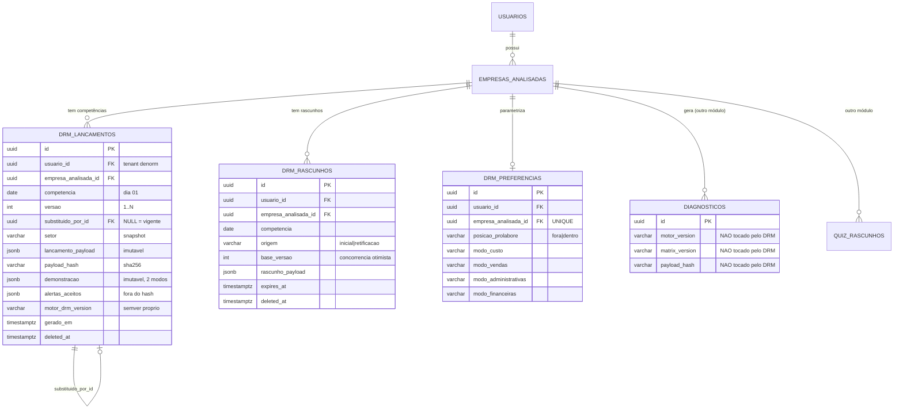
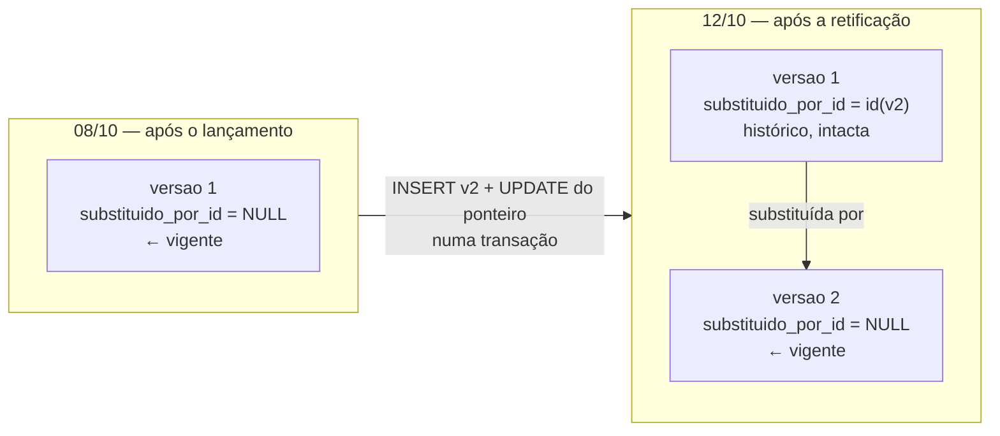

# ADR-007 — Modelo de dados do DRM, versionamento e retificação de competência

## Contexto

O `PDR-003` criou o módulo DRM e fixou, na decisão 7, que **retificação de competência é requisito de produto**: o usuário precisa corrigir um mês já lançado, a versão anterior precisa ser preservada, e a tela precisa sinalizar a correção. A cena é concreta e vai acontecer na primeira semana de uso real — Joana lança setembro no começo de outubro, concilia o extrato e descobre que errou a taxa da maquininha (`D10`).

Isso coloca o DRM em rota aparente de colisão com o `IDR-010`, que fixou para o Diagnóstico: snapshot persistido, JSON imutável após `INSERT`, sem recálculo retroativo, `motor_version` carimbado no registro. Nas palavras da própria IDR: *"Edição = novo diagnóstico (novo `id`)"*. Se o lançamento do DRM for igualmente imutável, o módulo é inutilizável. Se for livremente editável, perdemos a trilha e a série histórica muda debaixo do usuário sem explicação.

**A colisão é aparente e desaparece quando se separam duas coisas que o IDR-010 não precisou separar:**

- **Imutabilidade do registro** — uma linha persistida nunca é alterada depois de gravada. É isso que o IDR-010 estabelece, e é o que dá reprodutibilidade e auditabilidade.
- **Mutabilidade do conceito** — "a competência 09/2026 da Empresa X" é uma identidade de negócio estável que, ao longo do tempo, aponta para registros diferentes.

O Diagnóstico nunca precisou da segunda porque não tem identidade de negócio persistente: cada diagnóstico *é* um evento isolado, e dois diagnósticos da mesma empresa em datas diferentes são legitimamente dois objetos. A competência do DRM é o oposto — ela é **única por Empresa Analisada** (regra B1 do Anexo K) e o usuário se refere a ela como uma coisa só ("o setembro que eu lancei"). É essa unicidade que exige o conceito de *versão* e de *versão vigente*, ausentes no Diagnóstico.

Por isso esta ADR **estende** o IDR-010 a um segundo módulo, acrescentando a camada de identidade que o Diagnóstico não tem. Ela **não revoga nem restringe** o IDR-010, que segue vigente e inalterado para o Diagnóstico.

Precisamos decidir agora porque a `STORY-045` bloqueia as cinco estórias de implementação do épico (`STORY-047` a `STORY-051`), e porque retificação decidida no meio da implementação vira migração dolorosa depois que existirem lançamentos reais.

### Restrições herdadas que esta decisão respeita sem reabrir

- `ADR-003` — Eloquent + migrations Laravel; multi-tenancy por FK `usuario_id` + Global Scope + Policy; PK UUID v7; enums por `CHECK`; FK `RESTRICT` por padrão; soft delete + purga LGPD; audit log app-side.
- `IDR-009` — 404 silente em acesso cross-tenant.
- `IDR-010` — vigente para o Diagnóstico; princípio de snapshot herdado pelo DRM.
- `PDR-003` — módulo independente, competência de primeira classe e única por empresa, sem competência futura, regime de caixa puro.
- `PDR-004` — pró-labore parametrizável (`fora` default | `dentro`) como **parâmetro de apresentação, nunca de cálculo**; Lucro Líquido idêntico nos dois modos; linhas não operacionais aprovadas.
- `Anexo K` §K.5 (modos agregado/detalhado), §K.5-A (parâmetros da empresa), §K.6 (regras B1–B4 e A1–A6), §K.7 (sem faturamento), §K.9 (rascunho, retificação, pré-preenchimento).
- `design/estrutura-drm.md` §7 — motor puro, aritmética exata, ordem de linhas no contrato, snapshot versionado.

## Forças (drivers) da decisão

| ID | Força | Peso | Origem |
|---|---|---|---|
| **F1** | Retificação preserva a versão anterior de forma recuperável, e a tela sinaliza | **Alto** | `PDR-003` dec. 7; `STORY-050` CA-2/CA-4 |
| **F2** | Nenhuma corrupção do IDR-010 nem do `payload_hash`/`motor_version` do Diagnóstico | **Alto** | `STORY-045` pergunta 8; `PDR-003` (razão de descarte da Opção 3) |
| **F3** | Sem recálculo retroativo — o passado é o que o usuário viu | **Alto** | `epic.md` fora de escopo; `IDR-010` sub-decisão 4 |
| **F4** | Ausência de lançamento ≠ mês zerado — a série depende disso | **Alto** | `estrutura-drm.md` §4; `STORY-051` CA-2 |
| **F5** | Duplo submit não cria dois lançamentos da mesma competência | **Alto** | Anexo K B1; `STORY-045` pergunta 3 |
| **F6** | Simplicidade (princípio #1) — time muito pequeno, módulo novo inteiro nesta onda | **Alto** | Princípio #1 e restrição de time |
| **F7** | Postgres-first (princípio #3) — invariantes no banco quando o banco sabe garanti-las | **Alto** | Princípio #3; `ADR-003` |
| **F8** | Coesão alta / acoplamento baixo (princípio #5) — DRM e Diagnóstico não se contaminam | **Alto** | Princípio #5; `PDR-003` dec. 1 |
| **F9** | Comparativos consistentes após retificação, sem valor obsoleto em cache | **Médio** | `STORY-050` CA-5; `STORY-051` CA-9/CA-10 |
| **F10** | Testabilidade (princípio #10) — invariantes verificáveis em Pest sem heroísmo | **Médio** | Princípio #10; `quality-standards` |
| **F11** | Reversibilidade (princípio #7) — o modelo não pode hipotecar a `STORY-058` (provisão) nem o vínculo futuro DRM→Diagnóstico | **Médio** | Princípio #7; `PDR-003` consequências; `PDR-004` dec. D |
| **F12** | Custo de espaço e de leitura da série (24 competências em ≤ 2s p95) | **Baixo** | `STORY-051` CA-11 |

---

## Opções consideradas — Decisão 1: mecânica de retificação

### Opção A — Mutação do registro com audit trail

Uma linha por competência. Retificar faz `UPDATE` nos valores e grava `before`/`after` em `audit_logs`.

- ✅ **Simplicidade**: uma tabela, uma linha, zero conceito novo.
- ❌ **F1**: a versão anterior existe apenas no audit log, que é infraestrutura de auditoria, não fonte de leitura de produto. Reconstruir "o que o usuário via em 12/10" exige replay de JSON de audit — frágil e não testável como contrato.
- ❌ **F2/F3**: o snapshot deixa de ser imutável. Contradiz frontalmente o princípio do IDR-010, e teríamos dois regimes opostos convivendo sem justificativa de domínio.
- ❌ **F10**: "a versão anterior é recuperável" vira asserção sobre o formato do audit log.

### Opção B — Versão nova append-only na mesma tabela, com ponteiro de vigência (**adotada**)

Uma linha por **versão** de competência. Retificar **insere** a versão `N+1` e marca a versão `N` como substituída. A versão vigente é a única que não foi substituída.

- ✅ **F1**: cada versão é um registro completo e legível; a anterior é recuperável por `SELECT`, não por arqueologia.
- ✅ **F3**: nenhum registro existente é recalculado. Retificar é um **ato novo do usuário**, não recálculo retroativo.
- ✅ **F5/F7**: a unicidade da competência vigente é um índice único parcial — o Postgres resolve a corrida, não a aplicação.
- ✅ **F6**: uma tabela, duas colunas de controle (`versao`, `substituido_por_id`). Nada de máquina de estados.
- ✅ **F10**: os invariantes viram asserções triviais ("existe exatamente uma versão vigente", "a soma das versões é contígua a partir de 1").
- ⚠️ **Trade-off**: inserir a versão `N+1` exige um `UPDATE` de metadado na versão `N` (o ponteiro). O conjunto financeiro continua imutável — ver *Fronteira de imutabilidade* abaixo.
- ⚠️ **Trade-off**: espaço cresce com o número de retificações. Irrelevante em ordem de grandeza (ver §Custo).

### Opção C — Tabela corrente + tabela de histórico

`drm_lancamentos` (mutável, sempre a versão corrente) + `drm_lancamentos_versoes` (cópia da versão anterior antes de cada update).

- ✅ **F1**: preserva o anterior.
- ❌ **F6**: duas tabelas com o mesmo schema, dupla escrita, dois models, duas migrations a cada evolução de coluna. Padrão clássico de drift entre corrente e histórico.
- ❌ **F2**: a linha corrente continua sendo mutada — mesmo problema conceitual da Opção A, só que com backup.
- ❌ **F10**: os testes precisam cobrir a consistência entre as duas tabelas, que é exatamente o bug que o padrão introduz.

### Opção D — Event sourcing da competência

Persistir eventos (`LancamentoCriado`, `CampoCorrigido`) e projetar o estado.

- ❌ **F6**: violação frontal do princípio #1. Complexidade de projeção, replay e versionamento de evento, sem nenhuma dor real que a justifique.
- ❌ **F12/F10**: toda leitura de série vira projeção; testes de motor deixam de ser sobre um payload e passam a ser sobre uma sequência.
- Registro pelo princípio #12: descartada por desproporção, não por incapacidade técnica.

### Matriz comparativa — Decisão 1

| Força | Peso | A (mutação) | **B (append-only + ponteiro)** | C (corrente + histórico) | D (event sourcing) |
|---|---|---|---|---|---|
| F1 — versão anterior recuperável | Alto | ❌ só no audit log | ✅ registro de primeira classe | ✅ | ✅ |
| F2 — não corrompe IDR-010 | Alto | ❌ regime oposto | ✅ estende o princípio | ❌ linha corrente mutada | ⚠️ terceiro regime |
| F3 — sem recálculo retroativo | Alto | ⚠️ ambíguo | ✅ explícito | ⚠️ | ✅ |
| F5 — idempotência do submit | Alto | ⚠️ app-side | ✅ índice único parcial | ⚠️ | ❌ complexo |
| F6 — simplicidade | Alto | ✅ máxima | ✅ 2 colunas de controle | ❌ schema duplicado | ❌ |
| F10 — testabilidade | Médio | ❌ | ✅ invariantes em SQL | ⚠️ | ⚠️ |
| F12 — custo | Baixo | ✅ | ✅ ~8 KB/versão | ⚠️ 2× | ⚠️ |

---

## Opções consideradas — Decisão 2: onde mora o resultado calculado

### Opção E — Snapshot persistido junto à versão do lançamento (**adotada**)

A mesma linha guarda o **insumo** (`lancamento_payload`) e a **saída do motor** (`demonstracao`), gravados na mesma transação, com `motor_drm_version` carimbado.

- ✅ **F3**: herda integralmente o IDR-010. Reabrir um mês antigo lê JSON e renderiza; o motor não é invocado na leitura.
- ✅ Atomicidade semântica: é impossível existir saída que não corresponda ao insumo, porque nascem juntas e nunca são alteradas.
- ✅ `STORY-049` CA-8 (rodapé mostra a versão do snapshot) sai de graça.
- ⚠️ Espaço: ~8 KB por versão (ver §Custo).

### Opção F — Recalcular a cada leitura

Persistir só o lançamento; chamar o motor em toda exibição.

- ✅ Zero espaço redundante; um bug de motor se corrige para todo o histórico.
- ❌ **F3**: é literalmente recálculo retroativo, proibido pelo `epic.md`. Um bump de motor mudaria silenciosamente a série histórica inteira do usuário — o cenário que o IDR-010 existe para impedir.
- ❌ **F12**: a série de 24 competências vira 24 invocações de motor por página.
- ❌ Métrica de qualidade do épico: *"zero divergência entre o valor exibido na tela e o recalculado a partir do snapshot"* pressupõe que exista snapshot.

### Opção G — Snapshot só do resultado, insumo derivado

Descartado sem análise pesada: sem o insumo persistido não há pré-preenchimento do mês seguinte, não há reabertura para retificação e não há golden test ponta-a-ponta. Insumo e saída são ambos necessários.

**Decisão óbvia:** E. O IDR-010 já resolveu esta pergunta para o produto, com a mesma força de argumento; o DRM não traz nenhum fato novo que justifique divergir.

---

## Decisão proposta

> **Optamos pela Opção B (retificação) + Opção E (snapshot).**

O módulo DRM ganha **três tabelas próprias**, com prefixo `drm_`, sem nenhuma FK para as tabelas do Diagnóstico:

1. **`drm_lancamentos`** — uma linha por **versão de competência**. Append-only quanto ao conteúdo financeiro. Guarda insumo canonicalizado, hash, snapshot da demonstração nos dois modos de pró-labore, e a versão do motor. A versão vigente é a que não tem `substituido_por_id`.
2. **`drm_rascunhos`** — reaproveita integralmente o padrão de `quiz_rascunhos`, com uma chave a mais (competência) e duas colunas de origem (lançamento inicial vs. retificação).
3. **`drm_preferencias`** — parâmetros por Empresa Analisada do §K.5-A (posição do pró-labore, modo de cada um dos quatro grupos). Não afetam cálculo nem lançamento.

Comparativos e faróis **não são persistidos**: são derivados na leitura sobre os snapshots vigentes.

---

## Respostas às 8 perguntas da STORY-045

### 1. Retificação

**Nova versão, append-only, com ponteiro de vigência.**

- Retificar **insere** `versao = N+1` e faz `UPDATE drm_lancamentos SET substituido_por_id = <id da N+1> WHERE id = <id da N>`, tudo numa transação, com `SELECT … FOR UPDATE` na vigente.
- **Vigente** = `substituido_por_id IS NULL AND deleted_at IS NULL`. Índice único parcial garante **exatamente uma** por `(empresa_analisada_id, competencia)`.
- Nenhuma versão é apagada. Nenhuma versão tem seu conteúdo financeiro alterado.

**Como a tela sabe que houve retificação e quantas vezes** — sem nenhuma coluna extra e sem `COUNT`:

| Leitura da tela | Origem |
|---|---|
| "este mês foi retificado" | `versao > 1` na linha vigente |
| "corrigido 2 vezes" | `versao - 1` |
| "última correção em 12/10/2026" | `gerado_em` da linha vigente |
| "ver como estava antes" | `WHERE empresa_analisada_id=? AND competencia=? ORDER BY versao` |

**Fronteira de imutabilidade (regra dura, verificável por teste arquitetural):**

- **Imutável após `INSERT`:** `competencia`, `versao`, `setor`, `lancamento_payload`, `payload_hash`, `demonstracao`, `motor_drm_version`, `gerado_em`.
- **Mutável (metadado de ciclo de vida, nunca conteúdo):** `substituido_por_id` (uma única vez, de `NULL` para um id, jamais de volta) e `deleted_at`.

O `UPDATE` do ponteiro é o único desvio em relação ao "nunca `UPDATE`" do IDR-010, e ele não toca em nada que o usuário viu. A alternativa sem `UPDATE` — ponteiro para trás (`substitui_id` na versão nova) — foi considerada e descartada: "a vigente é a linha que ninguém aponta" não é expressável como índice único, o que jogaria o invariante mais importante do modelo para dentro da aplicação, contra a força F7.

**Auditoria (`STORY-050` CA-7):** `AuditLogger::log()` com `action = 'drm.lancamento.retificado'`, `before = {versao: N, payload_hash: …}`, `after = {versao: N+1, payload_hash: …}`. O audit log **não** duplica o payload financeiro — a versão anterior já é um registro recuperável de primeira classe; copiá-la para o audit criaria duas fontes da verdade para o mesmo fato.

### 2. Snapshot

**Persistido, como no Diagnóstico. Nunca recalculado.**

- `demonstracao` (jsonb) guarda a saída completa do motor: linhas com código, nível, rótulo, valor nominal, percentual e motivo de indisponibilidade.
- **O snapshot é auto-descritivo.** A camada de leitura renderiza o que está no JSON; não hardcoda `L1..L11`. Consequência direta: um bump MAJOR que mude a estrutura de linhas não quebra a renderização de meses antigos.
- **Os dois modos de pró-labore vivem no mesmo snapshot** (`demonstracao.linhas.fora[]` e `demonstracao.linhas.dentro[]`), com rótulos já resolvidos em cada um. Alternar o modo é escolher o outro array — sem recálculo, sem migração, sem "em que modo este mês foi lançado", exatamente como o `PDR-004` §B promete. Persistir os rótulos (em vez de resolvê-los por config na leitura) é deliberado: é a lição registrada no aditivo de 2026-08-04 do IDR-010, quando uma troca de uma palavra em texto de veredito se revelou output do motor, e não texto de render.

**Evolução do motor:**

- `motor_drm_version` em semver, com as mesmas regras do IDR-010 (MAJOR = fórmula ou estrutura de linha muda; MINOR = linha ou setor novo; PATCH = correção que altera output). Valor inicial `1.0.0`, em `config/drm.php`. **Contador independente do `motor_version` do Diagnóstico — bumpar um nunca bumpa o outro.**
- **Sem `matrix_version` no DRM.** O módulo não usa a matriz do Diagnóstico (`STORY-048` fora de escopo) e não tem, hoje, nenhum dado editorial validado externamente dentro do cálculo.
- **Sem recálculo retroativo.** Uma competência retificada é calculada com o motor vigente **no momento da retificação** e carimbada com ele. É por isso que a cadeia de versões de um mesmo mês pode exibir versões de motor diferentes: isso é rastreabilidade, não inconsistência. Nenhuma competência **não retificada** é tocada por um bump.

**Faróis (`STORY-054`) ficam fora do snapshot** — decisão de fronteira que precisa de ciência do PO. As faixas de farol por setor ainda não têm validação da EBC e vão mudar. Persisti-las congelaria faixas não validadas na história; derivá-las na leitura significa que um farol **pode mudar de cor retroativamente** quando a EBC calibrar as faixas. Isso é o comportamento correto aqui: no DRM o farol é *interpretação* de um número já congelado, enquanto no Diagnóstico o texto da matriz é *medição validada externamente* e por isso entra no snapshot. Os valores nominais e percentuais — que são o produto — nunca mudam.

### 3. Identidade e idempotência

| Nível | Chave |
|---|---|
| Identidade de negócio | `(empresa_analisada_id, competencia)` |
| Identidade da versão | `(empresa_analisada_id, competencia, versao)` |
| Identidade técnica | `id` UUID v7 |

**Tipo de `competencia`: `date` com dia fixo em 01**, com `CHECK (EXTRACT(DAY FROM competencia) = 1)`. Não `varchar('MM/AAAA')`. Motivo: ordenação, comparação e aritmética de intervalo (mês anterior, detecção de lacuna do alerta A6, janela de 12 meses) saem grátis do Postgres. `MM/AAAA` é formato de apresentação.

**Duplo submit — duas camadas, nesta ordem:**

1. **Banco (autoritativa).** O índice único parcial `(empresa_analisada_id, competencia) WHERE substituido_por_id IS NULL AND deleted_at IS NULL` faz o segundo `INSERT` concorrente falhar. A corrida é resolvida pelo Postgres, não por `if (exists)` — que sempre tem janela. A aplicação captura a violação de unicidade e a trata como "já existe": redireciona para o lançamento existente, que é o comportamento da regra B1 do Anexo K.
2. **Hash (semântica).** `payload_hash` = SHA-256 do `lancamento_payload` canonicalizado. Se um submit de retificação chega com hash **idêntico** ao da versão vigente, **não** se cria a versão `N+1`: a operação é no-op e retorna a versão existente.

O ponto 2 é uma **divergência deliberada do IDR-010**, que explicitamente recusou unicidade em `payload_hash` porque reemitir o mesmo diagnóstico em duas datas é ato legítimo. No DRM não é: "retificar" sem mudar nenhum valor não é correção, e contá-la inflaria o contador que a tela mostra ao usuário ("corrigido 3 vezes" quando nada mudou). Note a assimetria: **não** há unicidade global de hash — dois meses com valores idênticos são normais e continuam sendo duas versões `1`. A comparação é só contra a vigente da mesma competência.

**Canonicalização:** mesmas cinco regras do IDR-010 (chaves ordenadas recursivamente, decimais como string com casas fixas, string vazia → `null`, booleanos literais, UTF-8 NFC). **Restrição arquitetural dura:** seja qual for o mecanismo escolhido pelo Programador — extrair um canonicalizador genérico compartilhado ou manter dois —, **o DRM não pode ser capaz de alterar `diagnosticos.payload_hash`**. Se o caminho for compartilhar, os golden hashes do Diagnóstico são o estopim obrigatório: qualquer alteração que mexa no output do Diagnóstico derruba o CI antes de chegar em produção. O mecanismo concreto é decisão do Programador (IDR); a restrição não é negociável.

**O que entra no hash:** todos os valores `D01`–`D42` e o **modo de cada grupo** (agregado vs. detalhado muda a granularidade do registro, logo é conteúdo). **O que fica fora:** `alertas_aceitos` (ato do usuário, não insumo de cálculo — mesma lógica que mantém `gerado_em` fora do hash no IDR-010) e `gerado_em`.

### 4. Modo agregado vs. detalhado

**Ambos, com papéis distintos — e o Anexo K §K.5 já fixou os dois:**

- **Preferência** (o que o formulário abre): em `drm_preferencias`, por Empresa Analisada, uma coluna por grupo. Reaplicada no lançamento seguinte.
- **Fato** (o que aquele mês realmente é): **carimbado dentro do snapshot**, em `lancamento_payload.modos` e refletido na `demonstracao`. É o que determina a granularidade disponível na série histórica, e por isso entra no `payload_hash`.

**Por que a preferência mora em tabela própria e não em colunas de `empresas_analisadas`:** princípio #5. `empresas_analisadas` pertence ao EPIC-001; o DRM não deve fazer o módulo de cadastro crescer a cada parâmetro seu. Uma tabela própria mantém a fronteira do módulo e torna a evolução (`STORY-058` pode acrescentar `tratamento_sazonal`) uma migration que não toca em tabela core. Trade-off aceito: uma tabela a mais e um `JOIN` na leitura, ambos triviais.

**Série histórica com granularidades mistas** (`STORY-051` CA-8): a estrutura de linhas de nível 1 é idêntica nos dois modos, então **todo comparativo de nível 1 está sempre disponível**. Comparativo de item detalhado é `indisponivel:grupo_agregado` nos meses em que aquele grupo estava agregado. **Proibição explícita: nunca inferir o valor de um item a partir do total do grupo** — seria inventar dado que o usuário não forneceu. O modelo sustenta a regra porque o modo está no snapshot de cada mês, e não apenas na preferência atual da empresa.

### 5. Ausência vs. zero

**Mês não lançado = ausência de linha. Mês sem movimento = linha com zeros.** O modelo não precisa de nada além disso — e é justamente por isso que ele precisa proibir o contrário.

- **Nunca existe linha "placeholder" zerada.** Não há estado `nao_lancado` no banco.
- A série é montada na **camada de leitura**: gera-se a espinha de meses da janela (do primeiro lançamento até o mês corrente) e faz-se `LEFT JOIN` com as versões vigentes. Mês sem correspondente → `indisponivel:sem_lancamento`.
- **`COALESCE(valor, 0)` é proibido em qualquer query de série.** É a forma exata como "quedas fantasma" entram num produto.
- Lançamento com `deleted_at` preenchido conta como **ausente**, nunca como zero.
- Rascunho aberto é um terceiro estado, visível (`STORY-051` CA-1), e vive em `drm_rascunhos` — nunca em `drm_lancamentos`.

### 6. Multi-tenancy

**Herança integral do `ADR-003` + `IDR-009`, sem nenhuma novidade:**

- `usuario_id UUID NOT NULL` FK → `usuarios` `RESTRICT`, denormalizado para Global Scope sem `JOIN`; trait `BelongsToUsuario` nas três tabelas.
- `empresa_analisada_id UUID NOT NULL` FK → `empresas_analisadas` `RESTRICT`.
- Policies por operação; acesso cross-tenant e competência inexistente retornam **404 silente** (`IDR-009`) — indistinguíveis por desenho.
- Enums por `CHECK`, PK UUID v7, `timestampTz`.
- Soft delete `deleted_at` em `drm_lancamentos` e `drm_rascunhos`; cascata a partir do `Usuario` via Service, não por `ON DELETE CASCADE` físico.
- **Todos os índices únicos são parciais com `deleted_at IS NULL`** — convenção do projeto, permite relançar uma competência após soft delete.
- **Desvio declarado:** `drm_preferencias` **não** tem soft delete. Não contém PII nem valor histórico; é configuração. `ADR-003` restringe soft delete a "entidades de domínio com PII".
- **LGPD:** os lançamentos do DRM seguem o precedente já estabelecido para `Diagnostico` no `ADR-003` §Decisão 5 — mantidos como agregáveis anonimamente sob legítimo interesse, com `usuario_id` preservado para integridade referencial. Esta ADR **herda** a política, não cria uma nova; qualquer revisão de DPO que atinja `diagnosticos` atinge `drm_lancamentos` igualmente.

### 7. Rascunho

**Reaproveita o padrão de `quiz_rascunhos`. O pré-preenchimento não exige mecânica própria.**

- Tabela separada `drm_rascunhos` — rascunho nunca mora em `drm_lancamentos`, mesma separação que o IDR-010 fixou e o PO ratificou para o quiz.
- Chave: `(usuario_id, empresa_analisada_id, competencia)` — uma a mais que o quiz, porque o usuário pode ter setembro em rascunho e começar outubro.
- `expires_at` com TTL de 90 dias e hard delete por job, no mesmo padrão do `ExpurgarRascunhosExpirados`.

**Pré-preenchimento é semente de leitura, não estrutura.** Ao abrir um lançamento novo, o payload do rascunho é inicializado a partir da `demonstracao`/`lancamento_payload` da versão vigente da competência anterior, com uma lista `repetidos: [campos]` no próprio payload jsonb para a tela marcar visualmente até a confirmação. Nada disso toca no schema — o payload já é jsonb.

**Retificação passa pelo mesmo caminho**, o que mantém um único fluxo de submit:

- Reabrir uma competência fechada cria um rascunho com `origem = 'retificacao'` e `base_versao = N`, semeado com o lançamento vigente.
- Um rascunho de retificação abandonado **nunca** toca na versão vigente. Não existe estado intermediário visível ao usuário.
- **Concorrência otimista:** se, no submit, `base_versao ≠ versao` da vigente (outra sessão retificou enquanto este rascunho estava aberto), o submit é recusado com pedido de reabertura. Uma coluna, e o lost update deixa de ser possível.

### 8. Convivência com o Diagnóstico

**Declaração explícita da fronteira. Nada no DRM pode afetar `payload_hash`, `motor_version` ou `matrix_version` do Diagnóstico.**

| Fronteira | Regra |
|---|---|
| Tabelas | Prefixo `drm_`. **Zero FK** entre tabelas do DRM e `diagnosticos` / `quiz_rascunhos`, nas duas direções. |
| Ponto de contato | Somente `usuarios` e `empresas_analisadas`, e **apenas como leitura** (além das próprias FKs). Nenhuma migration do EPIC-010 altera coluna de tabela do Diagnóstico. |
| Motor | Namespace `App\Domain\Drm` próprio. `config/drm.php` próprio. `motor_drm_version` é campo distinto de `motor_version` e tem contador independente. |
| Matriz | O DRM **não usa** a matriz do Diagnóstico e não tem `matrix_version`. |
| Golden tests | Conjuntos separados. Golden hash de DRM nunca aparece em teste de Diagnóstico e vice-versa. |
| Canonicalização | Restrição da pergunta 3: o DRM não pode ser capaz de alterar `diagnosticos.payload_hash`. Golden hashes do Diagnóstico são o estopim em CI. |
| `IDR-013` | `App\Support\Relatorio\ValoresNominais` é do Diagnóstico. O DRM **não** o consome e **não** o estende — no DRM os nominais vêm do próprio snapshot, que é o que o IDR-013 não pôde fazer retroativamente. |
| Eventos | `STORY-056` usa o `EventLogger` existente. Nomes de evento com prefixo `drm_`. Nenhuma alteração de schema em `evento_produto`. |
| Vínculo futuro | O `PDR-003` prevê que 12 meses de DRM possam um dia pré-preencher o Diagnóstico. O modelo **não impede** — a consulta por empresa é direta —, e **não implementa**. Nenhuma FK é necessária para isso; seria uma leitura. |

---

## Relação com o IDR-010 (CA-2)

> **Esta ADR estende o IDR-010 a um segundo módulo, acrescentando uma camada de identidade que o Diagnóstico não tem. O IDR-010 não é revogado, não é substituído e não tem seu alcance restringido. Ele segue vigente e inalterado para o Diagnóstico.**

Três pontos de contato, nomeados:

1. **Princípio herdado sem alteração.** Snapshot persistido, JSON nunca editado após `INSERT`, versão do motor carimbada no registro, sem recálculo retroativo. É a mesma regra, aplicada a um segundo domínio.
2. **Refinamento, não contradição.** O IDR-010 diz *"Edição = novo diagnóstico (novo `id`)"*. O DRM aplica exatamente isso: retificar cria um registro novo com `id` novo. O que o DRM acrescenta é o que fazer quando o objeto tem **identidade de negócio persistente** — a cadeia de versões e o ponteiro de vigência. O Diagnóstico não precisou disso porque cada diagnóstico é um evento isolado; a competência é uma coisa só que muda de conteúdo.
3. **Uma divergência deliberada, com justificativa de domínio.** O IDR-010 recusou unicidade em `payload_hash` porque reemitir o mesmo diagnóstico é ato legítimo. O DRM usa o hash para **bloquear uma retificação no-op**, porque "corrigir" sem mudar valor não é correção e mentiria para o usuário no contador de retificações. A divergência é de semântica de domínio, não de princípio — e vale só contra a versão vigente da mesma competência, nunca globalmente.

Consequência prática: nenhuma linha do IDR-010 precisa mudar. Fica registrada nesta ADR a relação, e o `index.json` liga as duas decisões.

---

## Esboço de esquema (CA-4)

> Convenções do `ADR-003` e do `database-schema.md`: nomes em português, PK `uuid` v7, enums por `CHECK`, FK `RESTRICT` por padrão, `timestampTz`, unique parcial com `deleted_at IS NULL`. A migration definitiva é da `STORY-047` — este esboço é contrato, não código.

### `drm_lancamentos` — versão de competência (append-only)

| Coluna | Tipo | Notas |
|---|---|---|
| `id` | `uuid` PK | UUID v7 |
| `usuario_id` | `uuid` NOT NULL | FK → `usuarios` `RESTRICT`. Tenant denormalizado (Global Scope) |
| `empresa_analisada_id` | `uuid` NOT NULL | FK → `empresas_analisadas` `RESTRICT` |
| `competencia` | `date` NOT NULL | Dia sempre 01. `CHECK (EXTRACT(DAY FROM competencia) = 1)` |
| `versao` | `integer` NOT NULL | `CHECK (versao >= 1)`. `1` = lançamento original |
| `substituido_por_id` | `uuid` NULL | FK → `drm_lancamentos.id` `RESTRICT`. `NULL` ⇒ **versão vigente** |
| `setor` | `varchar(16)` NOT NULL | `CHECK IN ('industria','comercio','servicos')`. Snapshot do setor no momento — a estrutura de campos depende dele (§K.4) e o setor da empresa pode mudar |
| `lancamento_payload` | `jsonb` NOT NULL | `D01`–`D42` canonicalizados + `modos` por grupo. Imutável |
| `payload_hash` | `varchar(64)` NOT NULL | SHA-256 hex do payload canônico. `CHECK (payload_hash ~ '^[0-9a-f]{64}$')` |
| `demonstracao` | `jsonb` NOT NULL | Snapshot auto-descritivo das linhas, nos dois modos de pró-labore. Imutável |
| `alertas_aceitos` | `jsonb` NOT NULL DEFAULT `'[]'` | Alertas A1/A2/A3/A5 aceitos no fechamento (§K.6). **Fora do hash** |
| `motor_drm_version` | `varchar(16)` NOT NULL | `CHECK (motor_drm_version ~ '^\d+\.\d+\.\d+$')` |
| `gerado_em` | `timestamptz` NOT NULL | Momento do cálculo desta versão |
| `created_at` / `updated_at` | `timestamptz` | Padrão Laravel |
| `deleted_at` | `timestamptz` NULL | Soft delete |

**Índices e constraints:**

| Nome | Definição | Serve a |
|---|---|---|
| `drm_lancamentos_vigente_unique` | UNIQUE `(empresa_analisada_id, competencia)` WHERE `substituido_por_id IS NULL AND deleted_at IS NULL` | Regra B1, idempotência do duplo submit **e** índice de leitura da série histórica (o mesmo btree, varrido em ordem inversa) |
| `drm_lancamentos_versao_unique` | UNIQUE `(empresa_analisada_id, competencia, versao)` WHERE `deleted_at IS NULL` | Integridade da cadeia; leitura do histórico de versões |
| `drm_lancamentos_usuario_idx` | `(usuario_id)` | Global Scope |
| `drm_lancamentos_motor_idx` | `(motor_drm_version)` | Análise pós-bump (precedente IDR-010) |

**Não vira `CHECK`:** competência futura (regra B2) depende de `now()`, que não é `IMMUTABLE` e o Postgres recusa em `CHECK`. Fica como validação de aplicação, no mesmo lugar das demais regras do §K.6.

**Sem coluna `vigente`.** Ela seria redundante com `substituido_por_id IS NULL` e as duas derivariam. Um único representante, usado direto no predicado do índice parcial e num scope `->vigente()` do Eloquent.

### `drm_rascunhos` — rascunho retomável

| Coluna | Tipo | Notas |
|---|---|---|
| `id` | `uuid` PK | |
| `usuario_id` / `empresa_analisada_id` | `uuid` NOT NULL | FKs `RESTRICT` |
| `competencia` | `date` NOT NULL | Mesmo `CHECK` de dia 01 |
| `origem` | `varchar(16)` NOT NULL | `CHECK IN ('inicial','retificacao')` |
| `base_versao` | `integer` NULL | Versão que se está retificando. `CHECK ((origem = 'retificacao') = (base_versao IS NOT NULL))` |
| `rascunho_payload` | `jsonb` NOT NULL | Valores parciais + `modos` + `repetidos[]` (pré-preenchimento) + progresso. Sem canonicalização — ela é trabalho do submit |
| `expires_at` | `timestamptz` NOT NULL | TTL 90 dias, renovado a cada save |
| `created_at` / `updated_at` / `deleted_at` | `timestamptz` | |

**Índices:** UNIQUE `(usuario_id, empresa_analisada_id, competencia)` WHERE `deleted_at IS NULL`; `(usuario_id, expires_at)` — espelha `quiz_rascunhos`.

### `drm_preferencias` — parâmetros da Empresa Analisada (§K.5-A)

| Coluna | Tipo | Notas |
|---|---|---|
| `id` | `uuid` PK | |
| `usuario_id` | `uuid` NOT NULL | FK `RESTRICT` — Global Scope |
| `empresa_analisada_id` | `uuid` NOT NULL | FK `RESTRICT`. UNIQUE |
| `posicao_prolabore` | `varchar(8)` NOT NULL DEFAULT `'fora'` | `CHECK IN ('fora','dentro')` (`PDR-004` dec. B) |
| `modo_custo` / `modo_vendas` / `modo_administrativas` / `modo_financeiras` | `varchar(16)` NOT NULL DEFAULT `'agregado'` | `CHECK IN ('agregado','detalhado')` |
| `created_at` / `updated_at` | `timestamptz` | Sem soft delete — configuração, sem PII |

Linha criada preguiçosamente no primeiro acesso ao módulo, com os defaults. O default `'agregado'` dos quatro grupos segue o argumento anti-atrito do `PDR-003` dec. 6 (9 campos em vez de 38 no primeiro mês) e é **override livre da `STORY-046`/`STORY-047`** se o spec de design decidir diferente — é uma linha de migration, não estrutura.

**Omissão declarada (princípio #12):** `tratamento_sazonal` **não** entra agora. O §K.5-A registra um único valor legal (`caixa`) enquanto a `STORY-058` não concluir, e coluna de valor único é peso morto. Gatilho de inclusão: a `STORY-058` aprovar um segundo tratamento.

### Diagrama ER e fronteira com o Diagnóstico



> **Leitura do diagrama:** a única ligação entre o DRM e o Diagnóstico é o ancestral comum `EMPRESAS_ANALISADAS`. Não há aresta direta entre `DRM_LANCAMENTOS` e `DIAGNOSTICOS` — e a ausência dessa aresta é a decisão, não um esquecimento.

---

## O requisito de produto, demonstrado (CA-3)

Joana, Empresa Analisada `E`, setor Comércio.

**08/10 — lança setembro.** Rascunho `origem='inicial'`, semeado com agosto. Ao fechar:

```
INSERT drm_lancamentos
  competencia=2026-09-01  versao=1  substituido_por_id=NULL
  payload_hash=a1b2…  motor_drm_version=1.0.0  gerado_em=2026-10-08 21:14
DELETE (soft) drm_rascunhos da competência
```

Tela mostra a demonstração. `versao = 1` ⇒ **sem selo de retificação**.

**12/10 — concilia o extrato e vê que `D10` (taxa de cartão) estava errada.** Aciona "corrigir este mês": cria rascunho `origem='retificacao'`, `base_versao=1`, semeado com os valores atuais. Ao confirmar, uma transação:

```
SELECT … FOR UPDATE  (a vigente, versao=1)
verifica base_versao(1) == versao vigente(1)          -- concorrência otimista
verifica hash novo != a1b2…                            -- retificação no-op é bloqueada
INSERT versao=2, substituido_por_id=NULL, gerado_em=2026-10-12 09:30
UPDATE versao=1 SET substituido_por_id=<id da versao 2>
AuditLogger: drm.lancamento.retificado {before:{versao:1,hash:a1b2…}, after:{versao:2,hash:c3d4…}}
```

Resultado, verificável linha a linha no banco:

| Requisito | Onde se verifica |
|---|---|
| A versão anterior **é preservada** | A linha `versao=1` continua lá, intacta, com o `demonstracao` que Joana viu em 08/10 |
| A versão anterior **é recuperável** | `WHERE empresa_analisada_id='E' AND competencia='2026-09-01' ORDER BY versao` |
| A tela **sinaliza a retificação** | `versao=2` na vigente ⇒ selo "retificado 1 vez, em 12/10/2026" (`gerado_em`) |
| **Nenhuma outra competência é recalculada** | Nenhum outro registro é tocado pela transação (`STORY-050` CA-3) |
| **Comparativos de outubro se ajustam** | Não há o que invalidar: comparativos são derivados na leitura sobre as vigentes (`STORY-050` CA-5) |
| **Trilha de auditoria** | `audit_logs` com autor, momento, `request_id` (`STORY-050` CA-7) |

**Fluxo do ponteiro de vigência:**



---

## Comparativos e faróis não são persistidos

Decisão que sustenta `STORY-050` CA-5 e `STORY-051` CA-9/CA-10 e merece ficar explícita, porque a alternativa é tentadora e errada.

- Variação vs. mês anterior, vs. média móvel, acumulado no ano e participação média são **derivados na leitura**, a partir dos snapshots das versões vigentes.
- Se fossem persistidos, retificar setembro exigiria invalidar e reescrever os snapshots de outubro, novembro, dezembro — ou seja, **recálculo retroativo**, exatamente o que o épico proíbe. O `CA-5` da `STORY-050` ("sem valores obsoletos em cache") deixa de ser um risco a gerenciar e passa a ser impossível por construção.
- Custo: 24 competências × ~8 KB de JSONB, uma query com o índice de vigência e aritmética exata em PHP. Confortavelmente dentro dos 2s p95 do `CA-11`. Se um dia não estiver, a saída é cache de leitura invalidável por `(empresa, competência)` — que é reversível e local, não estrutural.
- Faróis: mesma regra, pelos motivos da pergunta 2.

---

## Consequências

### Positivas

- O épico destrava: as cinco estórias bloqueadas ganham contrato de persistência fechado.
- Retificação é ganho de confiança sem custo de trilha: a versão anterior é registro de primeira classe, não entrada de log.
- A tela consegue tudo o que precisa (retificado? quantas vezes? quando?) sem nenhuma coluna dedicada e sem `COUNT`.
- O invariante mais importante do modelo — uma vigente por competência — é garantido pelo **Postgres**, não por código de aplicação (princípio #3 e #9).
- Alternar o modo de pró-labore é literalmente escolher o outro array do snapshot: a promessa do `PDR-004` §B ("alternar não recalcula nada, não quebra a série, não existe 'em que modo este mês foi lançado'") vira propriedade do modelo, não disciplina de implementação.
- O modelo não hipoteca a `STORY-058`: acrescentar provisão é uma coluna em `drm_preferencias` e, se a provisão exigir saldo acumulado, uma tabela nova — sem tocar em `drm_lancamentos`.

### Negativas / trade-offs aceitos

- **Espaço cresce com retificações.** ~8 KB por versão (payload + demonstração nos dois modos). 500 empresas × 12 meses × 1,3 versões ≈ 62 MB/ano. Irrelevante para o Postgres; registrado por honestidade.
- **A `demonstracao` guarda os dois modos**, praticamente dobrando o tamanho do bloco de linhas. A alternativa — derivar rótulos e linhas por config na leitura — foi rejeitada porque faria uma troca de rótulo reescrever a história, que é a armadilha registrada no aditivo de 2026-08-04 do IDR-010.
- **Um `UPDATE` no ponteiro** rompe o "nunca `UPDATE`" literal do IDR-010, ainda que não toque em conteúdo. Mitigado por fronteira de imutabilidade explícita + teste arquitetural.
- **Uma tabela a mais** (`drm_preferencias`) e um `JOIN` na leitura, em vez de colunas em `empresas_analisadas`. Pago em nome da fronteira de módulo.
- **Faróis podem mudar de cor retroativamente** quando a EBC calibrar as faixas. É o comportamento correto (o farol é interpretação), mas é uma diferença de comportamento em relação ao Diagnóstico e precisa aparecer para o usuário na `STORY-054`. **Item que pede confirmação explícita do PO.**
- **Não há exclusão de lançamento** no modelo. `STORY-050` põe isso fora de escopo (zerar = retificar com zeros) e a ADR não antecipa. Se virar requisito, é soft delete da cadeia inteira — barato, mas não decidido aqui.
- **Não há campo de "motivo da retificação".** Nenhuma estória pede. É uma coluna nullable de acréscimo trivial se o PO quiser.

### Neutras

- A cadeia de versões de uma mesma competência pode carregar `motor_drm_version` diferentes. É rastreabilidade, e a tela mostra a do snapshot vigente.
- `versao` não é global: cada competência tem sua própria contagem a partir de 1.
- `payload_hash` é redundante (derivável do payload) — aceito pelo mesmo motivo do IDR-010: permite comparação indexável e barata.

### Para o time — impacto por estória (CA-5)

| Estória | Premissas que pode assumir |
|---|---|
| **STORY-047** (lançamento) | Escreve em `drm_rascunhos` (`origem='inicial'`) e, no fechamento, insere `versao=1` em `drm_lancamentos`. Persiste `modos` **dentro** do payload e `alertas_aceitos` **fora** dele. Regra B1 é atendida pelo índice único parcial — trate a violação de unicidade como "já existe" e ofereça abrir/retificar; **não** dependa de um `exists()` prévio. Regra B2 (competência futura) é validação de aplicação, não `CHECK`. Preferências de modo vêm de `drm_preferencias` (criada preguiçosamente com defaults). Pré-preenchimento é semente do payload do rascunho + lista `repetidos[]` — sem estrutura nova. Campos suprimidos por setor são gravados **nulos**, nunca zero. O `setor` é copiado para o lançamento no fechamento. |
| **STORY-048** (motor) | Motor puro em `App\Domain\Drm`, `config/drm.php` com `version = '1.0.0'`, **contador independente** do Diagnóstico e **sem `matrix_version`**. Recebe payload + competência + carimbo por parâmetro. Devolve `demonstracao` auto-descritiva com **os dois modos de pró-labore resolvidos, rótulos inclusos** — CA-1b e CA-3b da `STORY-049` caem fora do motor e viram escolha de array. Golden tests próprios, sem qualquer contato com os do Diagnóstico. Aritmética exata; nominais serializados como string com casas fixas (regra 2 da canonicalização). |
| **STORY-049** (tela do mês) | Lê **só** o snapshot da versão vigente; nunca invoca o motor (CA-8). Renderiza **genericamente** a lista de linhas do JSON — não hardcode `L1..L11`, senão um bump MAJOR quebra a exibição de meses antigos. Troca de modo = trocar de array + gravar `posicao_prolabore` em `drm_preferencias`. Rodapé usa `motor_drm_version` e `gerado_em` **do snapshot**. `alertas_aceitos` vêm da coluna própria (CA-7). Selo de retificação disponível via `versao > 1` (a UI plena é da `STORY-050`). Cross-tenant e competência inexistente: 404 silente. |
| **STORY-050** (retificação) | **Contrato completo já está aqui.** Rascunho `origem='retificacao'` + `base_versao`; transação `SELECT FOR UPDATE` → checagem de `base_versao` → checagem de hash no-op → `INSERT versao=N+1` → `UPDATE` do ponteiro → audit. CA-2 e CA-4 saem do modelo. CA-3 (nenhuma outra competência recalculada) é consequência estrutural. CA-5 é impossível de violar, porque comparativo não é persistido. B1 não se aplica na retificação, como a estória já previu. **Comparação lado a lado entre versões ficou barata** (as versões são registros completos) — se o PO quiser, é tela, não modelo. |
| **STORY-051** (série e comparativos) | Lê versões vigentes por `(empresa_analisada_id, competencia)` no índice de vigência. **Espinha de meses gerada na leitura + `LEFT JOIN`**; ausência ⇒ `indisponivel:sem_lancamento`; `COALESCE(…, 0)` proibido (CA-2). Comparativos derivados, nunca persistidos (CA-10). Granularidade mista resolvida pelos `modos` gravados em cada snapshot; item de mês agregado ⇒ `indisponivel:grupo_agregado`, **nunca inferido do total** (CA-8). A4 e A6 são computados na validação contra as vigentes anteriores; a marca de atípico é derivada, não coluna. Mês retificado exibido via `versao > 1` (CA-9). |
| **STORY-054** (faróis) | Faixas **não** entram no snapshot; farol é derivado na leitura. Consequência a comunicar na tela: recalibrar faixas muda cores retroativamente, e os valores não mudam. |
| **STORY-055 / STORY-053** (exportação) | Exportam a partir do snapshot da vigente, no modo vigente. Nada de invocar motor. Uma exportação de mês retificado exporta a versão vigente e deve indicar a versão. |
| **STORY-056** (eventos) | `EventLogger` existente, nomes com prefixo `drm_`, payload carregando `motor_drm_version` e `versao`. Sem alteração de schema em `evento_produto`. |
| **STORY-057** (validação) | Ganha os invariantes desta ADR como itens verificáveis de checklist (ver *Plano de verificação*). |
| **STORY-058** (spike de provisão) | **Não é hipotecada.** Se a provisão for aprovada, o saldo acumulado é tabela nova + um valor a mais em `drm_preferencias`; `drm_lancamentos` não muda de forma. Se for rejeitada, nada acontece. |

### Decisões que esta ADR **não** toma (princípio #12)

- Estrutura de pastas, nomes de classe, composição de componentes Livewire — do Programador.
- Mecanismo concreto de canonicalização compartilhada vs. duplicada — do Programador, dentro da restrição da pergunta 3.
- Layout, rótulos finais e textos — `STORY-046` e `STORY-052`.
- Posição do pró-labore, faixas de farol, rótulos — decisões de negócio já tomadas (`PDR-004`) ou pendentes de EBC.
- Motor de exportação — `STORY-053`.
- Onde mora o saldo de provisão — `STORY-058`.

---

## Plano de verificação

### Como verificar conformidade

- **Invariante "uma vigente por competência":** garantido pelo índice único parcial. Teste Pest tenta inserir duas vigentes e espera `QueryException`.
- **Invariante "cadeia contígua":** teste assere que as versões de uma competência formam `1..N` sem lacuna e que exatamente uma tem `substituido_por_id IS NULL`.
- **Imutabilidade:** teste arquitetural no padrão já usado pelo `Diagnostico` — tentar `update()` em qualquer coluna do conjunto imutável falha; `substituido_por_id` só transiciona `NULL → valor`, nunca o contrário.
- **Duplo submit:** teste de concorrência com dois submits da mesma competência ⇒ um lançamento, resposta idempotente.
- **Retificação no-op:** submeter retificação com payload idêntico ⇒ `versao` não incrementa.
- **Concorrência otimista:** dois rascunhos de retificação com o mesmo `base_versao` ⇒ o segundo é recusado.
- **Ausência ≠ zero:** série com lacuna devolve `indisponivel:sem_lancamento`; grep/linter veta `COALESCE` em query de série.
- **Fronteira com o Diagnóstico:** teste arquitetural veta import de `App\Domain\Motor` dentro de `App\Domain\Drm` e vice-versa; os golden hashes do Diagnóstico rodam no mesmo CI e são o estopim de qualquer mudança de canonicalização.
- **Multi-tenant:** cross-tenant em toda rota do DRM ⇒ 404 (`IDR-009`).
- **Invariante do `PDR-004`:** Lucro Líquido idêntico nos dois arrays do snapshot (`STORY-048` CA-1c) — aqui vira asserção sobre o dado persistido, não só sobre o motor.

### Sinais de revisão (cada um reabre esta ADR)

1. **Mais de 30% dos lançamentos precisarem de retificação** — já é sinal de revisão do `PDR-003`; do lado técnico, sugeriria trazer comparação de versões e talvez motivo de retificação para o modelo.
2. **Série histórica acima de 2s p95** com volume real — introduzir cache de leitura invalidável por `(empresa, competência)`, sem mexer no modelo.
3. **Requisito de exclusão de competência** — soft delete da cadeia, decisão pequena mas não tomada aqui.
4. **`STORY-058` aprovar provisão com saldo acumulado** — reabre o `PDR-003` (o módulo deixaria de ser caixa puro) e, por consequência, esta ADR ganha o agregado de saldo.
5. **Vínculo DRM → Diagnóstico virar requisito** — hoje é leitura; se virar escrita, a fronteira da pergunta 8 precisa ser renegociada formalmente.
6. **Faixas estabilizarem após a calibração da EBC** e passarmos a querer congelar a interpretação por mês — acrescentar `conteudo_version` às versões criadas dali em diante é uma coluna e uma migration `expand`, sem tocar em nada já gravado. Enquanto as faixas não estiverem calibradas, congelar é estritamente pior (ver §Aditivo de 2026-08-04 sobre o CA-8 da `STORY-054`). Sinal secundário: farol mudando de cor virar reclamação recorrente de usuário apesar da sinalização na tela.

### Spike de código

**Não houve e não é necessário** (CA-6 da `STORY-045` é vacuamente atendido). A decisão não depende de validação empírica: todos os mecanismos usados — índice único parcial, `SELECT FOR UPDATE`, JSONB, soft delete, Global Scope — já estão em produção neste projeto, e as invariantes são verificáveis por teste na própria `STORY-047`. Nenhum branch `spike/STORY-045-*` foi criado; nada a mergear.

### Custo

Nenhum custo recorrente novo. Três tabelas no Postgres já existente. Espaço estimado: 500 empresas × 12 competências × 1,3 versões × ~8 KB ≈ **62 MB/ano**, mais índices. Dentro do envelope de qualquer VPS do `ADR-005`.

---

## Aprovação humana

- **Status final:** ✅ aceita
- **Aprovado por:** Alexandro (PO)
- **Data:** 2026-08-04
- **Forma do aceite:** aprovado em chat (sessão de 2026-08-04), com confirmação explícita dos quatro pontos submetidos.
- **Condicionantes do aceite:** nenhuma.

**Os quatro pontos submetidos ao PO, e as respostas — ratificados como parte da decisão:**

1. **CA-3 — o cenário demonstrado atende ao `PDR-003` dec. 7?** → **Sim.** O requisito de produto está atendido: retificar preserva a versão anterior como registro recuperável, e a tela sinaliza a correção e sua contagem.
2. **Faróis fora do snapshot** → **Confirmado.** Recalibrar as faixas da EBC **pode mudar a cor de meses antigos**; os valores nominais e percentuais **nunca** mudam. A assimetria em relação ao Diagnóstico (onde o texto da matriz entra no snapshot por ser medição validada externamente) é deliberada. **A `STORY-054` deve tornar isso legível ao usuário** — o farol é leitura, não medição.
3. **Retificação no-op bloqueada** → **Confirmado.** "Corrigir sem mudar nada" não incrementa `versao` e não aparece como retificação na tela.
4. **Sem campo de motivo da retificação e sem exclusão de lançamento** → **Confirmado.** Nenhum dos dois é requisito do MVP. Ambos permanecem como acréscimos baratos e reversíveis se virarem requisito (ver *Sinais de revisão* 1 e 3).

### Em caso de rejeição

- **Motivo:** —
- **Próximos passos sugeridos:** —

---

## Histórico

- 2026-08-04 — criada como `proposed` pelo Arquiteto (claude-opus-5) durante a `STORY-045` (spike). Quatro opções avaliadas para retificação (B adotada; A, C e D rejeitadas) e três para persistência do resultado (E adotada; F e G rejeitadas). Relação com o `IDR-010` declarada como **extensão**, com uma divergência deliberada (papel do `payload_hash`) justificada por semântica de domínio. `IDR-010` **não** é revogado nem tem alcance restringido.
- 2026-08-04 — **`accepted` pelo PO (Alexandro)** em chat, com confirmação explícita dos quatro pontos submetidos (ver §Aprovação humana). `STORY-045` movida para `done`; `STORY-047`, `STORY-048`, `STORY-049`, `STORY-050` e `STORY-051` destravadas. Ponteiro recíproco acrescentado ao `IDR-010` (`related_adrs`), sem alterar nenhuma decisão daquela IDR.

- 2026-08-04 — **Aditivo: resolução do conflito com o CA-8 da `STORY-054` (faróis).** Ao propagar o ponto 2 do aceite, apurou-se que o CA-8 daquela estória — escrita antes desta ADR — pedia o oposto: *"a versão do pacote de conteúdo é gravada no snapshot do lançamento; meses antigos preservam a leitura com que foram gerados"*. O PO delegou a decisão ao Arquiteto (*"tome estas decisões, precisamos encerrar isso"*) e ela foi tomada por **alinhar o CA-8 a esta ADR**: nada da camada de interpretação (faixa, farol, texto de leitura) entra no snapshot; tudo é derivado na exibição.

  **O fundamento decisivo é específico do DRM e não estava explícito no corpo desta ADR — fica registrado aqui.** O módulo vai ao ar com **todas as faixas `nao_calibrada`** (é o que o CA-1b da `STORY-054` chama de "o estado em que o módulo vai ao ar", e a `STORY-052` segue bloqueada aguardando a EBC). Congelar a interpretação por mês significaria que **todo mês lançado antes da calibração ficaria permanentemente sem farol**, e só os posteriores ganhariam cor — punindo justamente o usuário que adotou o módulo primeiro, com uma série cinza atrás e colorida à frente. Derivando na leitura, no dia em que a EBC calibra **a história inteira do usuário ganha interpretação de uma vez**. Some-se a isso que carimbar era inviável na ordem do épico (o snapshot nasce no CP1, os faróis são do CP3 — escrever em coluna imutável já gravada, o beco do `IDR-013`).

  **Contrapartida obrigatória, agora no critério da `STORY-054`:** a tela precisa nomear a diferença entre **medição** (valores nominais e percentuais, imutáveis) e **leitura** (farol e texto, recalibráveis), exibindo a versão do pacote de conteúdo em vigor. O que o CA-8 original protegia — não mudar o chão sob o usuário — continua protegido, ancorado no que de fato não muda. Teste dedicado: recalibrar uma faixa muda o farol de um mês antigo e não altera nenhum valor do snapshot daquele mês.

  Decisão barata de desfazer (princípio #7) — ver §Sinais de revisão 6.
