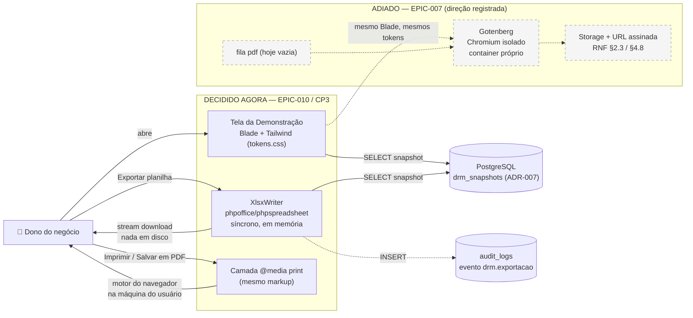

# ADR-008 — Motor de exportação de documentos

## Contexto

O produto ainda não gera **nenhum** documento. Não há linha de código de geração de PDF ou de planilha em lugar nenhum. A fila `pdf` existe no `command` do worker (`docker-compose.yml:52` e `infra/ansible/playbooks/templates/docker-compose.production.yml.j2:46`) desde a STORY-007 — herdada do planejamento original da ADR-002 — e **nenhum job a consome**. Esta é uma frente técnica inteiramente nova, e é a razão de a exportação estar no Checkpoint 3 do EPIC-010 e não antes.

A decisão tem **dois consumidores com necessidades diferentes**, e a STORY-053 exige explicitamente que ela seja validada contra os dois:

1. **EPIC-010 / DRM (agora).** O dono lança o mês e precisa levar o resultado para o contador, o sócio ou o gerente do banco. O artefato que ele quer é a **planilha** — é o formato em que ele consegue mexer, e foi de uma planilha (`Demonstração de Resultado Mensal - DRM.xlsx`, do Key User José Marques) que o módulo inteiro nasceu. O conteúdo é uma **tabela de ~17 linhas com duas colunas de números** (`design/estrutura-drm.md` §1).
2. **EPIC-007 / Relatório de Diagnóstico (depois).** O Roberto leva o relatório para a reunião com o banco. O conteúdo é um **documento denso**: resumo executivo, 14 indicadores com farol colorido e valor nominal, glossário, recomendações por indicador (`especificacao-funcional.md` §4.7; hoje renderizado em `app/resources/views/diagnosticos/show.blade.php`, 203 linhas de Blade sobre o design system). Aqui o artefato que importa é o **PDF** — planilha não serve para nada nesse caso de uso.

São dois problemas diferentes vestidos de um só, e tratá-los como um só é o erro que esta ADR precisa evitar. **A planilha é barata e resolve o DRM. O PDF é caro e não resolve o DRM — resolve o EPIC-007.**

Restrições concretas do contexto, apuradas nesta sessão:

- **A imagem de runtime hoje tem ~1,25 GB** (o target `dev`, que é `runtime` + Chromium, tem **1,81 GB**; a camada `apk add chromium chromium-chromedriver` mede **566 MB** em `docker history`). Ou seja: **botar Chromium na imagem deployada custa +45% de imagem**, em toda tag, todo push para o GHCR e todo pull no deploy da VPS. O número não é estimativa — é medido, e a ADR-002 (histórico de 2026-05-24) já registrou essa separação de targets exatamente para não pagar esse preço em homol/prod.
- **A imagem de runtime não tem `ext-gd`** (`docker-php-ext-install pdo_pgsql zip bcmath`). Tem `zip`, `mbstring`, `dom`, `xml*`, `fileinfo`, `iconv` (defaults da imagem oficial `php:8.5-cli-alpine`) e `libpng-dev` já instalado.
- **O design system tem fonte única de cor.** `resources/css/tokens.css` é o único arquivo autorizado a conter hex literal, e isso é **cobrado por teste arquitetural** (`tests/Unit/Arch/DesignTokensTest.php`, STORY-019 CA-6 + IDR-008). O arquivo tem hoje **duas exclusões documentadas** — `layouts/legal.blade.php` e os e-mails transacionais, que precisam de estilo inline porque clientes de e-mail ignoram CSS vars. Cada exclusão é uma cópia manual da paleta que alguém vai esquecer de atualizar.
- **O CSS é Tailwind v4 com `@theme`** (IDR-008): o output final depende de CSS custom properties (`var(--*)`), `@layer`, e recursos de layout modernos.
- **A homologação roda em VPS de 4 GB** (ADR-005 §1.1), com Postgres (`shared_buffers = 1GB`), php-fpm, worker, scheduler e Caddy no mesmo host.
- **O snapshot é a fonte** (ADR-007): a exportação lê o resultado persistido e imutável, nunca recalcula. Isso vale para os dois casos de uso (o Diagnóstico tem a mesma regra no IDR-010).
- **RNF §1.2** dá 10 s com feedback visual para "geração do PDF do relatório", e **RNF §2.3/§4.8** previram PDFs armazenados com URL assinada de 15 min e expurgo em 12 meses. Essas linhas foram escritas assumindo que haveria PDF gerado no servidor — não são um compromisso de que ele exista agora.

## Forças (drivers) da decisão

- **F1 — O que o usuário do DRM pediu foi a planilha.** **Alto.** O PDF do DRM é conveniência; a planilha é o pedido original, com nome e sobrenome (Key User, 03/08/2026). Uma decisão que atrasa a planilha para viabilizar o PDF inverte a prioridade do usuário.
- **F2 — Fidelidade visual sem segunda camada de layout.** **Alto.** Qualquer motor que não consuma o Blade + Tailwind reais obriga a escrever um **segundo layout** do mesmo documento, com uma **terceira cópia da paleta** fora do `tokens.css`. Isso viola o princípio #5 (uma razão para mudar) e exige nova exclusão no `DesignTokensTest`. Peso alto porque o EPIC-007 é justamente o caso denso.
- **F3 — Custo de imagem, build e superfície de segurança.** **Alto.** Princípios #1 e #11. +566 MB medidos por Chromium embarcado; Chromium é uma das maiores superfícies de CVE em software livre e renderiza HTML arbitrário dentro da nossa rede.
- **F4 — Menos peças móveis.** **Alto.** Princípio #1. Cada componente novo (container, fila viva, storage de artefato, estado "gerando" na UI) é incidente, log, alerta e teste a mais para um time de uma pessoa.
- **F5 — LGPD e retenção.** **Alto.** Um documento armazenado é dado financeiro pessoal em repouso, com titular, prazo, expurgo, URL assinada e direito de eliminação. Um documento transmitido e não armazenado não tem nada disso.
- **F6 — Verificabilidade em teste (princípios #9 e #10).** **Alto.** A STORY-055 CA-10 exige "verificação de conteúdo do arquivo gerado, não só do status da resposta". Conferir célula de XLSX em Pest é trivial (relê com a mesma lib). Conferir conteúdo de PDF exige extrair texto de um binário — teste frágil, ou teste que só verifica que "veio um PDF".
- **F7 — Servir os dois casos de uso.** **Alto.** Exigência explícita da STORY-053 (CA-2). Uma decisão boa para o DRM e ruim para o EPIC-007 seria dívida disfarçada de entrega.
- **F8 — Funcionamento 100% local.** **Alto.** Princípio #6. Qualquer motor tem que subir no `docker compose up`, sem internet. Isso desqualifica SaaS de HTML→PDF de saída.
- **F9 — Reversibilidade.** **Médio.** Princípio #7. Adiar o PDF é reversível (é decidir depois). Enfiar Chromium na imagem e depois tirar é reversível tecnicamente, mas o custo já foi pago em build, deploy e revisão de segurança.
- **F10 — Custo recorrente.** **Médio.** Princípio #11. Um container de renderização a mais na VPS de 4 GB pode ser o componente que força o upgrade de plano.

## Duas decisões, não uma

Esta ADR separa deliberadamente dois eixos que a pergunta original tratava junto:

| Eixo | Serve | Custo | Decisão |
|---|---|---|---|
| **Planilha** | DRM (EPIC-010) | baixo | **decidir e entregar agora** |
| **PDF gerado no servidor** | Relatório (EPIC-007); conveniência no DRM | alto | **adiar, com direção registrada** |

Tratar os dois como um pacote único ("motor de exportação") é o que faria o CP3 do EPIC-010 carregar o custo de abertura de uma frente técnica que **não é dele** — é do EPIC-007.

---

## Eixo 1 — Planilha

### Opções consideradas

#### Opção E1 — CSV

- **Resumo:** `fputcsv` na saída, zero dependência.
- **Princípios:** ✅ #1 (o mais simples que existe), ✅ #11 (grátis).
- **Prós:** dependência zero; abre em qualquer lugar; streaming trivial.
- **Contras concretos:**
  - **Não tem fórmula, não tem formatação, não tem hierarquia.** A demonstração tem três níveis de linha (`estrutura-drm.md` §1) e uma coluna de percentual — em CSV vira texto plano indistinguível.
  - **Armadilha de locale brasileira:** Excel em pt-BR espera `;` como separador e `,` como decimal. Errar isso entrega um arquivo em que **todos os números viram texto** numa coluna só. Acertar significa gerar CSV pt-BR que quebra em qualquer outro locale. Não há resposta certa, só escolha de quem vai reclamar.
  - **Falha o CA-2 da STORY-055** ("reconhecível por quem conhece o modelo do Key User"). O modelo do Key User é uma planilha formatada, com fórmulas.
- **Veredicto:** rejeitada. Barata demais para o que a estória pede.

#### Opção E2 — XLSX via `openspout/openspout`

- **Resumo:** escritor de planilha em streaming, memória constante. Requer `ext-dom`, `ext-filter`, `ext-libxml`, `ext-xmlreader`, `ext-zip` — **todos já presentes na imagem**. `~1 MB` de vendor.
- **Princípios:** ✅ #1, ✅ #11, ✅ #6.
- **Prós:** dependência mínima; nenhuma mudança no Dockerfile; formatação básica (negrito, cor, formato numérico) suportada.
- **Contras concretos:**
  - **Não escreve fórmulas.** OpenSpout é um escritor de valores; não há tipo de célula de fórmula. A planilha sai 100% estática.
  - Streaming de memória constante é a razão de existir da lib — e é uma vantagem que **não temos problema para colher**: nosso arquivo tem ~50 linhas.
- **Veredicto:** viável, mas perde para E3 exatamente no ponto que o usuário pediu (F1).

#### Opção E3 — XLSX via `phpoffice/phpspreadsheet` ✅

- **Resumo:** biblioteca completa de planilha em PHP puro (v5.9.0, `php: ^8.2`). Escreve fórmulas, formatação, múltiplas abas, larguras, congelamento de painel. Vendor ~9 MB (com `markbaker/complex`, `markbaker/matrix`, `zipstream-php`).
- **Custo de imagem:** requer `ext-gd`, que **não está instalada**. Adicionar `gd` ao `docker-php-ext-install` (o `libpng-dev` já está no `apk add`) custa **~3 MB de imagem** e alguns segundos numa camada que já é cacheada. Demais extensões exigidas (`ctype`, `dom`, `fileinfo`, `filter`, `iconv`, `libxml`, `mbstring`, `simplexml`, `xml`, `xmlreader`, `xmlwriter`, `zip`, `zlib`) já existem.
- **Princípios:**
  - ✅ **#1 Simplicidade:** uma dependência PHP, nenhum processo, nenhum container, nenhuma fila.
  - ✅ **#3 Postgres-first:** não adiciona armazenamento — o arquivo nunca toca disco.
  - ⚠️ **#4 Opinativo:** é biblioteca, não framework; a alternativa "opinativa Laravel" (`maatwebsite/excel`) é analisada em E4 e perde.
  - ✅ **#6 Local:** PHP puro, roda offline.
  - ✅ **#10 TDD:** o teste relê o arquivo gerado com a própria lib e confere célula a célula, **inclusive avaliando as fórmulas** (`getCalculatedValue()`).
  - ✅ **#11 Custo:** R$ 0 recorrente.
- **Prós concretos:**
  - **Fórmulas de verdade nas linhas derivadas.** O dono abre a planilha, muda uma despesa e vê o lucro do mês mudar. Isso é o que a planilha do Key User fazia (`=D<n>/D$2*100`) e é a razão pela qual ele quis planilha e não PDF.
  - **Hierarquia visível:** recuo, negrito nos totalizadores, formato de moeda BRL e formato percentual — o CA-2 ("reconhecível") deixa de ser subjetivo.
  - **XLSX guarda número como número**, independente de locale. A armadilha do CSV desaparece: o Excel pt-BR mostra vírgula, o LibreOffice en-US mostra ponto, e é o mesmo arquivo.
  - **Duas abas num arquivo só** resolvem o escopo de exportação sem UI de seleção de intervalo (ver §Escopo abaixo).
- **Contras concretos:**
  - Consumo de memória alto **por linha** comparado ao OpenSpout — irrelevante em ~50 linhas × 2 abas, e o teste de desempenho registrado abaixo cobre a hipótese de eu estar errado.
  - Uma extensão nova (`gd`) no Dockerfile para uma lib que só usa gd para imagens — que não vamos usar. É custo bobo, mas é 3 MB.
  - Superfície de biblioteca grande (leitor de XLS/ODS/HTML que nunca vamos usar). Mitigação: só o `Writer\Xlsx` é exercitado; nunca lemos arquivo de usuário — **não há upload nesta decisão**, então o vetor clássico de CVE de parser não se aplica.
- **Veredicto:** **escolhida.**

#### Opção E4 — XLSX via `maatwebsite/excel`

- **Resumo:** wrapper Laravel sobre o PhpSpreadsheet, com facades, `FromCollection`, exportação em fila.
- **Princípios:** ✅ #4 (é o "opinativo Laravel" do assunto), ⚠️ #7.
- **Contras concretos:**
  - **Acopla a exportação à versão major do Laravel.** O projeto está em Laravel 13 + Livewire 4 + PHP 8.5 — a borda mais nova possível. Um wrapper de terceiro é exatamente a dependência que trava um upgrade de framework, e o histórico dessa lib específica é de suporte tardio a majors do Laravel.
  - Traz abstrações (concerns, eventos de exportação, filas) que existem para casos de 100k linhas. Nosso caso é 50 linhas.
  - O ganho sobre E3 é `Excel::download($export)` em vez de `response()->streamDownload()` — que o Laravel já dá de graça.
- **Veredicto:** rejeitada. Princípio #4 pede aproveitar defaults do framework — e o default do Laravel para "mandar bytes ao navegador" é `streamDownload()`, não um pacote de terceiro.

### Matriz comparativa — planilha

| Critério (força) | Peso | E1 — CSV | E2 — OpenSpout | **E3 — PhpSpreadsheet** | E4 — maatwebsite |
|---|---|---|---|---|---|
| F1 — Entrega o que o usuário pediu (editável, com fórmula) | Alto | ❌ estático e sem forma | ⚠️ editável, sem fórmula | ✅ fórmulas nas linhas derivadas | ✅ (mesmo motor) |
| CA-2 STORY-055 — reconhecível vs. planilha do Key User | Alto | ❌ | ⚠️ sem hierarquia rica | ✅ | ✅ |
| F4 — Menos peças móveis | Alto | ✅ zero dep | ✅ 1 dep, 0 no Docker | ✅ 1 dep, +`gd` (3 MB) | ⚠️ 1 dep + acoplamento a major |
| F6 — Verificável em teste | Alto | ✅ | ✅ | ✅ inclusive avaliando fórmula | ✅ |
| F9 — Reversibilidade | Médio | ✅ | ✅ | ✅ trocar writer é local | ⚠️ trava upgrade de framework |
| F10 — Custo recorrente | Médio | ✅ R$ 0 | ✅ R$ 0 | ✅ R$ 0 | ✅ R$ 0 |
| Armadilha de locale pt-BR | Alto | ❌ inescapável | ✅ | ✅ | ✅ |

---

## Eixo 2 — PDF

### Opções consideradas

#### Opção P0 — Não gerar PDF no servidor; folha de estilo de impressão + "Imprimir / Salvar em PDF" do navegador ✅ (interina)

- **Resumo:** o navegador **já é** um motor de PDF, instalado na máquina do usuário, mantido por outra pessoa, custando zero. Uma camada `@media print` (ou as variantes `print:` do Tailwind, já disponíveis no IDR-008) sobre **o mesmo markup da tela** esconde navegação e ações, ajusta margens A4, evita quebra de página no meio de um grupo de linhas, e força as cores do farol a imprimirem (`print-color-adjust: exact`). O usuário faz `Ctrl+P → Salvar como PDF`.
- **Princípios:**
  - ✅ **#1:** zero peça nova. É CSS.
  - ✅ **#5:** um layout, uma fonte de verdade. Nenhuma cópia da paleta, nenhuma exclusão nova no `DesignTokensTest`.
  - ✅ **#6:** funciona local, sem internet, sem container.
  - ✅ **#11:** R$ 0.
  - ⚠️ **#10:** testável só parcialmente (dá para verificar em Dusk que o CSS de print existe e que os seletores certos são ocultados; não dá para verificar o PDF resultante, porque ele nem passa pelo nosso servidor).
- **Prós concretos:**
  - **A especificação já previa isso.** `especificacao-funcional.md` §4.7: *"Impressão é um atalho que abre a janela de impressão do navegador sobre a versão web."*
  - Nenhum artefato armazenado ⇒ nenhuma exposição de LGPD, nenhum expurgo, nenhuma URL assinada.
  - Zero risco de a exportação divergir da tela: **é** a tela.
- **Contras concretos, declarados sem maquiagem:**
  - **Não é um documento determinístico.** Chrome, Safari e Firefox paginam diferente. O resultado varia com a configuração de impressão do usuário.
  - **Cabeçalho e rodapé do navegador** (URL, data, "1/2") são do navegador, não nossos — dá para o usuário desligar, mas não dá para nós.
  - **Não serve para nada que exija o arquivo do lado do servidor** — anexar em e-mail, arquivar, enviar por link. Nada disso está no escopo do EPIC-010 (a STORY-055 lista explicitamente essas três coisas como fora de escopo), mas está no horizonte do produto.
  - **Não atende sozinho ao EPIC-007** como entrega definitiva, se o PO quiser que o relatório do banco seja um documento nosso, com nossa paginação e nosso rodapé de versão. Essa é uma decisão de produto, e está registrada abaixo como pergunta aberta ao PO.
- **Veredicto:** **escolhida como saída interina do EPIC-010.**

#### Opção P1 — Chromium embarcado na imagem (`spatie/browsershot` + Puppeteer, ou `chrome-php/chrome`)

- **Resumo:** o app chama um Chromium headless local, aponta para a URL autenticada (ou HTML renderizado) e recebe o PDF. Fidelidade perfeita: é o mesmo motor que desenha a tela.
- **Princípios:**
  - ✅ **#5:** um layout só. Este é o **grande** argumento a favor.
  - ❌ **#1 e #11:** **+566 MB medidos** na imagem deployada — de ~1,25 GB para ~1,82 GB, **+45%**. Isso é pago em cada build, cada push para o GHCR, cada pull da VPS em cada deploy (ADR-006).
  - ⚠️ **#6:** funciona local (o target `dev` já tem Chromium — para o Dusk), mas o `runtime` foi **deliberadamente separado** em 2026-05-24 justamente para não carregar isso.
  - ❌ **Segurança:** Chromium é uma das maiores superfícies de CVE existentes, e passa a rodar **dentro do nosso container de aplicação**, com acesso à rede interna e ao filesystem da app. Em container, exige `--no-sandbox` (que remove a principal defesa do Chromium) ou capabilities extras. Qualquer injeção no HTML do documento vira leitura de arquivo local ou SSRF contra o Postgres.
  - ⚠️ **#10:** verificar o conteúdo do PDF em teste exige extrair texto do binário.
- **Prós:** fidelidade total ao design system, sem segundo layout; roda no mesmo processo/worker.
- **Contras concretos:** todo o acima, mais: Puppeteer arrasta Node em runtime; `--no-sandbox` num container que também serve HTTP é uma decisão de segurança que precisa de dono.
- **Veredicto:** **rejeitada agora**; é a base séria da avaliação do EPIC-007, mas atrás de P2.

#### Opção P2 — Chromium como serviço isolado (Gotenberg em container próprio)

- **Resumo:** um container dedicado (`gotenberg/gotenberg`) expõe uma API HTTP `HTML → PDF`. A app manda o HTML renderizado + CSS e recebe o PDF. A imagem da aplicação **não muda**.
- **Princípios:**
  - ✅ **#5:** mesma fidelidade da P1, mesmo layout único.
  - ✅ **Segurança:** o Chromium fica **fora** do container da aplicação, sem credencial de banco, sem código nosso, com rede restrita a uma porta interna. É a diferença entre "o renderizador está dentro de casa" e "o renderizador está numa sala fechada".
  - ⚠️ **#1:** um container a mais no compose, em local, homologação e produção (6 → 7 containers, contando o Caddy).
  - ⚠️ **#2:** não é microsserviço nosso — é uma dependência de infraestrutura empacotada, mais próxima do Mailpit/Caddy do que de um serviço de domínio. Não viola o princípio #2, mas merece ser nomeado.
  - ⚠️ **#11:** imagem da ordem de 1 GB (**estimativa, não medida** — a validar no spike do EPIC-007) e consumo de RAM na casa das centenas de MB quando renderiza. Na VPS de homologação de 4 GB, com `shared_buffers = 1GB`, é o primeiro componente que empurraria um upgrade de plano (~R$ 40–60/mês).
  - ✅ **#6:** sobe no `docker compose up`, offline após o pull.
  - ✅ **#7:** trocar/remover é editar o compose e um client HTTP.
- **Veredicto:** **rejeitada agora**; é a **direção recomendada** para o spike do EPIC-007.

#### Opção P3 — Biblioteca PHP pura (`dompdf` / `mPDF`)

- **Resumo:** ~1–10 MB de vendor, PHP puro, nenhum processo novo. Aparentemente o caminho "simples".
- **Por que **não** é simples aqui, concretamente:**
  - **Nenhuma das duas renderiza o nosso CSS.** O `app.css` é Tailwind v4 com `@theme`, isto é, CSS custom properties (`var(--color-*)`, `var(--text-h1)`), `@layer`, e utilitários de layout modernos. dompdf tem suporte a CSS 2.1 com pedaços de CSS3 e **não resolve custom properties**; mPDF é melhor, mas também não.
  - **Consequência direta:** seria preciso escrever um **segundo template do documento**, com CSS próprio e **hex literais copiados à mão** — exatamente a terceira exclusão do `tests/Unit/Arch/DesignTokensTest.php`, ao lado do `legal.blade.php` e dos e-mails transacionais. A tela e o PDF passariam a ser dois documentos com duas verdades, e toda mudança de design system precisaria ser lembrada em dois lugares. Isso é violação frontal do princípio #5 e do que o IDR-008 se propôs a garantir.
  - Para o **DRM** (uma tabela) isso seria tolerável. Para o **EPIC-007** (14 indicadores, farol colorido, glossário, recomendações) é uma dívida com data marcada.
- **Princípios:** ✅ #1 na superfície, ❌ #5 no fundo, ⚠️ #11 (barato em bytes, caro em manutenção).
- **Veredicto:** **rejeitada para os dois casos de uso.** É a opção que parece a mais barata e é a mais cara — o custo dela não está na imagem, está no segundo layout que ninguém vai lembrar de atualizar.

#### Opção P4 — SaaS de HTML→PDF (DocRaptor, PDFShift, api2pdf)

- ❌ **#6 (100% local):** exige internet e credencial para o dev trabalhar, ou um mock a manter.
- ❌ **#11:** custo por documento, recorrente e proporcional ao sucesso do produto.
- ❌ **LGPD:** mandar a demonstração financeira do usuário (ou o diagnóstico) para um terceiro cria um **operador** de dados, com contrato, e provavelmente transferência internacional com TIA — exatamente o atrito jurídico que a ADR-005 §F3 evitou ao escolher VPS BR.
- **Veredicto:** rejeitada sem análise adicional.

#### Opção P5 — Status quo: não fazer nada no eixo PDF

- **Consequência:** o CA-3 da STORY-055 fica `n/a` e o usuário do DRM **não tem nenhuma forma** de levar a demonstração em papel. O `Ctrl+P` cru sobre a tela sai com o app shell, a navegação e os botões dentro do documento.
- **Veredicto:** rejeitada. É pior que P0 por uma diferença de custo desprezível (uma folha de estilo).

### Matriz comparativa — PDF

| Critério (força) | Peso | **P0 — print CSS** | P1 — Chromium na imagem | P2 — Gotenberg sidecar | P3 — dompdf/mPDF | P4 — SaaS | P5 — nada |
|---|---|---|---|---|---|---|---|
| F2 — Fidelidade sem 2º layout | Alto | ✅ é a própria tela | ✅ | ✅ | ❌ 2º layout + 3ª cópia da paleta | ✅ | n/a |
| F3 — Imagem / build / segurança | Alto | ✅ zero | ❌ +566 MB medidos, Chromium in-process | ⚠️ +1 container (~1 GB est.), isolado | ✅ ~10 MB | ✅ | ✅ |
| F4 — Peças móveis | Alto | ✅ nenhuma | ⚠️ fila + storage + estado na UI | ❌ container + fila + storage | ⚠️ fila + storage | ❌ dep. externa | ✅ |
| F5 — LGPD / retenção | Alto | ✅ nada em repouso | ⚠️ artefato armazenado | ⚠️ artefato armazenado | ⚠️ idem | ❌ operador terceiro | ✅ |
| F6 — Verificável em teste | Alto | ⚠️ parcial (Dusk) | ⚠️ extrair texto de binário | ⚠️ idem | ⚠️ idem | ❌ | n/a |
| F7 — Serve o EPIC-007 | Alto | ⚠️ serve se o PO aceitar impressão como resposta | ✅ | ✅ | ❌ | ✅ | ❌ |
| F8 — 100% local | Alto | ✅ | ✅ | ✅ | ✅ | ❌ | ✅ |
| F10 — Custo recorrente | Médio | ✅ R$ 0 | ✅ R$ 0 (VPS já paga) | ⚠️ possível upgrade de VPS | ✅ R$ 0 | ❌ por documento | ✅ |

---

## Decisão proposta

> **Optamos por separar os dois eixos.**
>
> **Decisão 1 — Planilha (agora, no EPIC-010).** A exportação da Demonstração de Resultado Mensal sai em **XLSX**, gerado por **`phpoffice/phpspreadsheet`**, **sob demanda e de forma síncrona**, transmitido por `response()->streamDownload()` e **nunca armazenado**. Origem dos dados é o **snapshot persistido** (ADR-007), nunca recálculo. Um único arquivo com **duas abas**: a competência aberta e a série histórica da Empresa Analisada.
>
> **Decisão 2 — PDF gerado no servidor (adiado ao EPIC-007).** **O PDF é caro demais para o Checkpoint 3 do EPIC-010, e recomendo entregar apenas a exportação em planilha, devolvendo o PDF ao EPIC-007.** Em consequência, o **CA-3 da STORY-055 passa a `n/a`**, como a própria estória previu.
>
> **Decisão 3 — Saída interina de impressão.** Para que "adiar o PDF" não signifique "o usuário fica sem nada em papel", a tela da Demonstração ganha uma **camada `@media print`** e um botão **"Imprimir / Salvar em PDF"**, que usa o motor de PDF do navegador sobre o **mesmo markup** da tela. Custo: uma folha de estilo. Sem container, sem fila, sem armazenamento, sem LGPD nova.
>
> **Decisão 4 — Direção registrada para o EPIC-007.** Quando o EPIC-007 abrir, o motor a validar em spike próprio é **Chromium isolado em container (Gotenberg)**, não biblioteca PHP pura. Ficam **desqualificados por antecipação**: dompdf, mPDF e qualquer motor que não consuma o Blade + Tailwind reais — porque forçam um segundo layout e uma terceira cópia da paleta fora do `tokens.css`.

## Justificativa

**Por que a planilha entra agora e o PDF não.** As duas coisas foram empacotadas na mesma estória porque parecem a mesma coisa ("exportar"). Tecnicamente não são nem parentes: a planilha é uma dependência de biblioteca e um loop sobre 17 linhas; o PDF é uma frente de infraestrutura com renderizador, fila, artefato armazenado, política de retenção e superfície de segurança nova. O que decide não é a dificuldade — é **a quem pertence o custo**. O PDF é o **objeto inteiro do EPIC-007**; pagar a abertura dessa frente dentro do CP3 do EPIC-010, para um documento de uma página que o usuário não pediu, é adiantar o custo de um épico e cobrar de outro.

**Por que síncrono.** A pergunta 1 da STORY-053 está formulada como se assincronia fosse a hipótese padrão — ela é, mas por herança: a fila `pdf` da ADR-002 foi dimensionada para o PDF do relatório, sob o RNF §1.2 de 10 s. **Sem PDF, o pressuposto some.** Escrever ~50 linhas em XLSX é trabalho de dezenas de milissegundos, dentro do orçamento de um request comum. Fazer isso assíncrono custaria: um job, uma fila viva, um artefato armazenado (para o worker entregar algo ao usuário), uma URL assinada, um estado "gerando" na tela, polling ou notificação, e o teste E2E de tudo isso — para transformar um download instantâneo numa espera. Seria complexidade contra o usuário. Princípio #1 em estado puro.

**Por que fórmulas na planilha.** A planilha do Key User tinha fórmulas, e é essa a razão de a exportação ser planilha e não PDF: o dono quer **mexer**. Uma planilha de valores estáticos é um PDF com bordas. Escrever as linhas derivadas como fórmula (`=B5-B7`, `=B12/B$4`) custa a mesma linha de código que escrever o número, e devolve um instrumento em vez de um retrato. O risco — a fórmula divergir do snapshot — é eliminado por teste, não por confiança (§Plano de verificação).

**Por que a impressão do navegador não é um consolo.** É a leitura honesta de uma assimetria: nós já temos um motor de renderização perfeito do nosso próprio HTML — o navegador do usuário — e a única coisa que falta para usá-lo é dizer o que não imprimir. Vale registrar que a **especificação funcional já dizia isso** para o relatório de Diagnóstico (§4.7). A opção P0 não é uma invenção para cobrir um adiamento; é o que estava escrito.

**Por que dompdf/mPDF são a armadilha desta decisão.** São a resposta que um analista apressado daria: "PHP puro, 5 MB, sem container, princípio #1". O custo real não está em bytes — está no **segundo layout**. O projeto tem um teste arquitetural que existe precisamente para impedir que cor de design system vaze para fora do `tokens.css`, e já carrega duas exclusões documentadas. Uma terceira, para um documento que é a saída principal do EPIC-007, garantiria que em algum momento a tela e o PDF do relatório mostrassem faróis de cores diferentes. Isso é violação do princípio #5 vestida de obediência ao #1.

### Trade-offs aceitos, explicitamente

- **O usuário do DRM não terá um PDF gerado pelo produto nesta onda.** Terá planilha e impressão do navegador. Se ele pedir "o PDF bonito", a resposta é EPIC-007.
- **A impressão do navegador é inconsistente entre navegadores.** Aceito: o público-alvo do DRM leva o papel ao contador, não ao investidor.
- **`phpoffice/phpspreadsheet` traz mais biblioteca do que usamos** e obriga uma extensão nova (`gd`, ~3 MB). Aceito em troca das fórmulas — que são a razão de a planilha existir.
- **A fila `pdf` continua declarada e vazia** no `command` do worker. Aceito: renomear exige tocar `docker-compose.yml`, o template Ansible de produção e o de homologação para ganho zero, e o EPIC-007 vai ocupá-la. Fica registrado aqui como **configuração intencionalmente morta**, para que ninguém a interprete como sinal de que existe geração assíncrona.
- **Adio uma decisão que a STORY-053 pediu que eu tomasse.** Adiar é uma resposta legítima e prevista (CA-8), mas não é de graça: o EPIC-007 começa com um spike a fazer. Mitigo isso deixando a Decisão 4 registrada, com opções já eliminadas — o spike do EPIC-007 não começa do zero, começa de P2 versus P1.

## Respostas diretas às 7 perguntas da STORY-053

| # | Pergunta | Resposta |
|---|---|---|
| **1** | Síncrono ou assíncrono? | **Síncrono**, com `streamDownload()`. A assincronia foi dimensionada para o PDF; sem PDF, ela é custo de UX sem contrapartida. A fila `pdf` permanece declarada e vazia até o EPIC-007. |
| **2** | Impacto na imagem de runtime | **Planilha:** `+~9 MB` de vendor e `+~3 MB` de `ext-gd`; camadas cacheadas, build praticamente inalterado; superfície de segurança desprezível (nunca **lemos** planilha de usuário — não há upload nesta decisão). **PDF via Chromium na imagem (rejeitado):** `+566 MB` medidos, `+45%` sobre os ~1,25 GB atuais, em todo push/pull, mais Chromium rodando dentro do container da aplicação. **Há caminho que evita isso:** sim — dois. O do agora é usar o navegador do usuário (P0); o do EPIC-007 é isolar o Chromium num container próprio (P2), deixando a imagem da aplicação intacta. |
| **3** | Fidelidade visual: reproduzir a tela ou layout A4 próprio? | **Reproduzir a tela**, com uma **camada de impressão** sobre o mesmo markup — não um layout paralelo. O critério que decide não é estético: um layout próprio significa CSS próprio, e CSS próprio significa hex literal fora do `tokens.css`, que o `DesignTokensTest` reprova e que o IDR-008 existe para impedir. Isso vale igualmente para o EPIC-007 e é o que desqualifica dompdf/mPDF. |
| **4** | Planilha: fórmulas ou valores estáticos? | **XLSX (Office Open XML), com fórmulas nas linhas derivadas** e valores nas linhas de entrada. XLSX porque guarda número como número — o CSV forçaria escolher entre quebrar no Excel pt-BR ou quebrar em todo o resto. Fórmulas porque é o que o usuário quer da planilha; e um teste garante que cada fórmula, avaliada, bate com o snapshot. |
| **5** | Retenção | **Gerado sob demanda e descartado.** O arquivo nunca toca o disco nem o storage. **Impacto de LGPD: nenhum novo dado pessoal em repouso** — não há artefato, não há prazo de guarda, não há URL assinada, não há expurgo. Isso **não revoga** o RNF §2.3/§4.8 (URL assinada de 15 min, expurgo em 12 meses): aquela política passa a valer quando o EPIC-007 introduzir documento armazenado. O que se registra é o **evento** da exportação no `audit_logs` (ADR-003), não o arquivo. |
| **6** | Escopo da exportação | **Um arquivo, duas abas, um clique:** aba 1 = a competência aberta; aba 2 = a série histórica completa da Empresa Analisada. **Sem seletor de intervalo** — a UI de intervalo (validação, competências faltantes, casos de borda) custa mais que o valor que entrega, porque quem precisa de "de março a agosto" está a um filtro de distância dentro da própria planilha. A série já está materializada pela STORY-051; a aba 2 é um segundo loop sobre dados que já existem. **Se a STORY-055 apertar, a aba 2 é a primeira coisa a cair** — a competência única é o mínimo inegociável. |
| **7** | Reaproveitamento pelo EPIC-007 | **A decisão de planilha não serve ao EPIC-007, e isto é dito sem rodeio:** o relatório de Diagnóstico é prosa, farol e glossário, não uma tabela para manipular; exportá-lo em XLSX não resolve o problema de ninguém. O que o EPIC-007 herda desta ADR é o **eixo do PDF**: a fidelidade tem que vir do Blade + Tailwind reais (§3), o que elimina bibliotecas PHP puras; o Chromium não entra na imagem da aplicação (§2); e o motor a validar é o **container isolado (Gotenberg)**. O EPIC-007 abre com um spike de validação, não com uma escolha em aberto. |

## Diagrama

**Legenda:** tracejado = adiado ao EPIC-007. O caminho decidido agora **não passa por fila, nem por storage, nem por container novo**. O ponteiro tracejado de `tela → goten` é o que torna a Decisão 4 coerente: o EPIC-007 renderiza o **mesmo Blade**, não um segundo layout.

## Consequências

### Positivas

- **O CP3 do EPIC-010 deixa de carregar a abertura de uma frente técnica que não é dele.** A STORY-055 encolhe de "planilha + PDF + fila + storage + retenção + UX de espera" para "planilha + folha de estilo".
- **A planilha entrega mais do que um PDF entregaria** para este usuário: ele mexe, simula, manda para o contador que mexe também.
- **Zero superfície nova de LGPD.** Nada em repouso, nada com prazo, nada para expurgar.
- **Zero impacto material em imagem, build e CI.** ~12 MB numa imagem de 1,25 GB.
- **O EPIC-007 herda uma decisão parcial em vez de uma folha em branco:** três opções já eliminadas com motivo, uma recomendada, e o critério que decide (fidelidade sem segundo layout) já nomeado.
- **A regra do `tokens.css` continua com duas exclusões, não três.**

### Negativas / trade-offs aceitos

- **Não há PDF do produto no EPIC-010.** Reconhecido, deliberado, e é a resposta ao CA-8 da STORY-053.
- **A impressão do navegador varia** entre navegadores e configurações; não temos controle da paginação nem do cabeçalho/rodapé do navegador.
- **Uma dependência e uma extensão novas** (`phpoffice/phpspreadsheet`, `ext-gd`) numa imagem que era enxuta.
- **A fila `pdf` fica declarada e vazia**, o que é confuso para quem lê o compose sem ler esta ADR. Mitigado por comentário no `docker-compose.yml` apontando para cá (tarefa da STORY-055).
- **A decisão de fórmulas cria um contrato novo a manter:** se a estrutura de linhas do DRM mudar (`estrutura-drm.md` §1), as referências de célula mudam junto. Mitigado pelo teste de avaliação de fórmula, que quebra se alguém mexer na ordem.

### Neutras

- O **`motor_drm_version`** e a marca de retificação (ADR-007) passam a aparecer no cabeçalho da planilha — a exportação é o primeiro lugar em que essas informações saem do produto e vão parar na mão de terceiros (contador, banco). Não é decisão nova, é consequência a notar.
- Esta ADR **não decide o layout** da planilha nem da folha de impressão — isso é design, e a própria STORY-053 põe fora de escopo. Decide o **mecanismo**.

### Para o time

- **Impacto em estórias existentes:**
  - **STORY-055 (Exportação):** **contrato fixado**. `CA-3` (PDF) → **`n/a`**, com a decisão registrada nas notas, como o próprio CA-3 instrui. `CA-4` (escopo) → competência aberta + aba de série histórica, sem seletor de intervalo. `CA-9` (desempenho e retenção) → síncrono, sem retenção; sem estado "gerando". `CA-10` → o teste de conteúdo lê o XLSX de volta e confere célula a célula, **inclusive avaliando as fórmulas**. **Sugestão ao PO** (não é minha alçada alterar CA): acrescentar um CA para a camada de impressão, ou realocá-la para a STORY-049.
  - **STORY-049 (Tela da Demonstração):** candidata natural a hospedar a camada `@media print`, se o PO preferir não inflar a STORY-055.
  - **STORY-051 (Série histórica):** vira **pré-requisito de conteúdo** da aba 2. Já é bloqueadora da STORY-055, então não muda o grafo.
  - **STORY-054 (Faróis e leitura):** desejável, não bloqueante — sem ela a planilha sai sem farol. Inalterado.
  - **STORY-056 (Eventos analíticos):** deve incluir o evento de exportação (`evento_produto`, ADR-004) — a taxa de exportação é sinal direto de valor percebido do módulo.
  - **EPIC-007:** ganha um spike de validação de motor de PDF como primeira estória. Não é regressão de escopo — é o custo real dele, que estava escondido no EPIC-010.
- **ADRs/PDRs relacionados que esta decisão limita ou destrava:**
  - **Destrava:** STORY-055.
  - **Limita:** qualquer estória futura que proponha dompdf, mPDF ou motor equivalente precisa argumentar contra o §P3 desta ADR **com o `DesignTokensTest` na mão**; qualquer estória que proponha Chromium dentro da imagem de runtime precisa argumentar contra os 566 MB medidos.
  - **Consome:** ADR-002 (fila `pdf`, imagem única, propagação de `request_id`), ADR-003 (audit log), ADR-005 (perfil da VPS, storage de PDFs), ADR-006 (custo de push/pull de imagem no pipeline), ADR-007 (snapshot como fonte), IDR-008 (Tailwind v4 + `tokens.css`).
- **Necessidade de spike de validação:** **não para a Decisão 1** — a STORY-055 absorve a validação naturalmente, e um spike separado para "escrever XLSX em PHP" seria cerimônia (princípio #1). **Sim para a Decisão 4**, dentro do EPIC-007, com fidelidade visual como critério de aceite e medição real da imagem e da RAM do Gotenberg (o "~1 GB" desta ADR é estimativa declarada, não número medido).

## Plano de verificação

### Como verificar conformidade

- **Teste de conteúdo, não de status** (STORY-055 CA-10): o teste gera o XLSX, relê com `PhpSpreadsheet\IOFactory` e confere **cada célula** contra o snapshot — valores, rótulos, ordem das linhas de `estrutura-drm.md` §1.
- **Teste de coerência das fórmulas** (é o que impede a planilha de mentir): para cada linha derivada, `getCalculatedValue()` da célula tem que ser **exatamente** o valor da mesma linha no snapshot. Se alguém mudar a ordem das linhas ou a fórmula, o teste quebra. Princípio #9 — automatizável em vez de documentável.
- **Teste arquitetural:** nenhuma classe do módulo de exportação pode invocar o motor do DRM. A fonte é o snapshot (STORY-055 CA-5, ADR-007). Verificável com regra Pest Arch sobre dependências.
- **Teste de escopo de acesso:** exportar competência de outro tenant retorna 404 silente (CA-6).
- **`DesignTokensTest` continua com duas exclusões.** Uma terceira exclusão aparecendo num PR é o sinal de que alguém está construindo um segundo layout de documento — é o gatilho de revisão desta ADR, não um detalhe de teste.
- **E2E (Dusk):** demonstração → exportar → arquivo recebido; e a camada de impressão verificada pela ausência dos seletores de navegação/ação no `@media print`.

### Sinais de revisão (cada um abre supersede, não edição silenciosa)

1. **p95 do tempo de geração da planilha > 2 s**, ou arquivo > 5 MB → reabrir a decisão "síncrono". Gatilho concreto: exportação em lote de muitas empresas × muitas competências.
2. **Pedido medido de PDF do DRM** — evento de produto de "tentou exportar PDF" ou chamados de suporte acima de um punhado — **antes** do EPIC-007 → antecipar a Decisão 2.
3. **EPIC-007 entra em sprint** → **gatilho de retomada da Decisão 2**. Abrir spike com: medição real da imagem e da RAM do Gotenberg na VPS de 4 GB, fidelidade do relatório renderizado contra a tela, e estratégia de teste do conteúdo do PDF.
4. **Feedback do beta indica que a impressão do navegador basta** para o relatório do banco → o EPIC-007 encolhe para uma folha de estilo, e esta ADR é substituída por uma versão simplificada. **Este é um resultado possível e desejável, não um fracasso.**
5. **Terceira exclusão no `DesignTokensTest`** proposta em qualquer PR → revisão imediata, independente de onda.
6. **Surgir requisito de anexar o documento em e-mail ou compartilhar por link** (hoje fora de escopo na STORY-055) → a geração sob demanda sem retenção não atende; reabrir Decisões 1 e 3 juntas.

### Estimativa de custo

| Item | Custo |
|---|---|
| `phpoffice/phpspreadsheet` + deps | ~9 MB de vendor, R$ 0/mês |
| `ext-gd` na imagem | ~3 MB, camada cacheada, R$ 0/mês |
| Camada `@media print` | 0 bytes de runtime, R$ 0/mês |
| Armazenamento de artefatos | **R$ 0** — não há artefato |
| **Delta total sobre a ADR-005** | **~R$ 0/mês, ~12 MB de imagem (+1%)** |
| *(Comparação — o que foi evitado)* | *Chromium na imagem: +566 MB (+45%); ou Gotenberg: +1 container, possível upgrade de VPS ~R$ 40–60/mês* |

## Fora de escopo (princípio #12 — restrições são informação)

Decisões deliberadamente **não** tomadas aqui:

- **Layout da planilha e da folha de impressão** — é design (a STORY-053 põe explicitamente fora de escopo). Esta ADR fixa mecanismo, formato e escopo; a forma é da STORY-046/Designer.
- **Motor definitivo de PDF do EPIC-007** — há **direção recomendada** (P2, Gotenberg) e **exclusões firmes** (P3, P4, e Chromium dentro da imagem), mas a escolha final exige o spike do próprio EPIC-007 com números medidos.
- **Exportação do relatório de Diagnóstico** — EPIC-007.
- **Envio por e-mail, link público, integração com nuvem** — fora na STORY-055 e fora aqui; se entrarem, invalidam "sem retenção" (sinal de revisão 6).
- **Renomear ou remover a fila `pdf`** — mantida por inércia deliberada, documentada.
- **Formatos alternativos** (ODS, Google Sheets, PDF/A, XML) — não pedidos por ninguém.
- **Personalização de layout ou marca do usuário** — fora na STORY-055.
- **Assinatura digital de documentos** — nunca foi pedida; se vier de requisito jurídico, é ADR nova.

---

## Aprovação humana

> Esta seção é o registro formal do aceite.

- **Status final:** ✅ **aceita**
- **Aprovado por:** Alexandro (PO)
- **Data:** 2026-08-06
- **Forma do aceite:** decisão registrada no `PDR-007` §3 e §4
- **Condicionantes do aceite:** nenhuma. A ADR vale **como escrita** — incluindo a Decisão 4, confirmada pela resposta à pergunta aberta abaixo.

### Pergunta aberta ao PO — **RESPONDIDA em 2026-08-06**

> **Resposta do PO (`PDR-007` §4): o PDF deve ser gerado pela plataforma, para garantir consistência sem depender do navegador do usuário.**
>
> A alternativa de aceitar a impressão do navegador **em definitivo** foi recusada. O documento em questão é o que o Roberto leva à reunião com o banco; um artefato que muda de paginação e possivelmente de cor conforme o navegador de quem imprime não é um documento nosso.
>
> **Consequências:** a **Decisão 4 vale como está** — Chromium isolado em container (direção Gotenberg, a validar em spike próprio), com `dompdf`, `mPDF` e SaaS de HTML→PDF seguindo desqualificados por antecipação. A camada `@media print` da Decisão 3 permanece **saída interina, não solução final**. O **EPIC-007 abre com o spike de motor de PDF** como primeira estória.

Texto original da pergunta (histórico)

A Decisão 4 assume que o EPIC-007 vai querer um **documento gerado pelo produto**, com nossa paginação e rodapé de versão. Há uma alternativa legítima que **elimina o EPIC-007 técnico inteiro**: aceitar que "Salvar PDF" seja, em definitivo, a impressão do navegador sobre uma folha de estilo bem-feita. Isso trocaria o épico por uma estória, ao custo de o documento que o Roberto leva ao banco variar conforme o navegador dele.

Essa é uma decisão de **qualidade de produto**, não de arquitetura — por isso não a tomo. Se o PO responder "a impressão basta", esta ADR é substituída por uma versão mais simples e o EPIC-007 encolhe drasticamente. Se responder "quero documento nosso", a Decisão 4 vale como está.

### Em caso de rejeição

- **Motivo:** —
- **Próximos passos sugeridos:** —

---

## Histórico

- 2026-08-06 — **aceita pelo PO** (`PDR-007` §3 e §4), sem condicionantes. A pergunta aberta foi respondida: **PDF é documento da plataforma**, não impressão do navegador — a Decisão 4 vale como está e o EPIC-007 abre com spike de motor de PDF. A camada `@media print` fica registrada como saída interina, não como solução final.
- 2026-08-04 — criada como `proposed` pelo Arquiteto (STORY-053, spike de motor de exportação). Números de imagem (1,81 GB do target `dev`; camada de 566 MB do Chromium; 55 MB de vendor) medidos nesta sessão com `docker history` sobre `defonline/app:dev`. Requisitos de extensão de `phpoffice/phpspreadsheet` 5.9.0 e `openspout/openspout` 5.10.1 conferidos no Packagist. O "~1 GB" atribuído ao Gotenberg é **estimativa declarada**, a medir no spike do EPIC-007.
