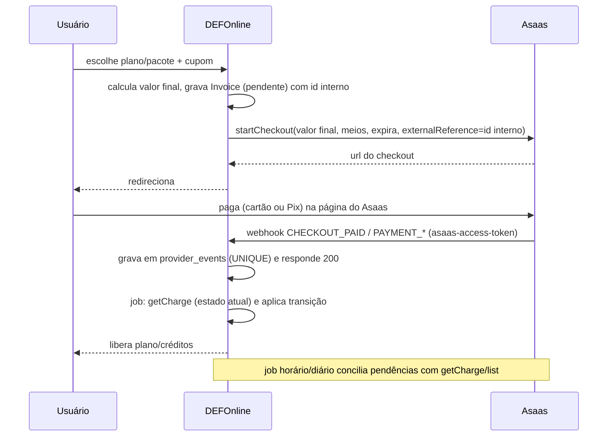

# ADR-010 — Abstração do provedor de pagamento e integração com o Asaas

> **Estado das evidências.** Cada afirmação sobre o Asaas traz a URL da documentação oficial (`docs.asaas.com`) ou o rótulo **[sandbox]**, resultado real obtido com `scripts/asaas-sandbox-verificar.sh` em 2026-11-05 contra `api-sandbox.asaas.com`. O que **não** foi possível confirmar está marcado **PENDENTE DE CONFIRMAÇÃO NO SANDBOX** (ou em produção) e listado na seção "Pendências" com o passo exato para fechá-lo. Enquanto houver pendência crítica, o ADR permanece `proposed`.

## Contexto

O PDR-020 escolheu o Asaas e exigiu que trocar de provedor não altere regras de negócio. A cobrança envolve dinheiro de cliente e dado de cartão; o NRF §3.2 pede cartão com recorrência, Pix com QR de 30 minutos, webhook, retentativas (3 em 48h) e estorno (arrependimento de 7 dias), e proíbe armazenar dado de cartão. O padrão de abstração de provedor já existe no projeto (`RfbCnpjClient`, IDR-004: interface + implementação `mock` + implementações reais escolhidas por `config/services.php`).

Cobrança é uma integração de **estado e eventos**, não de request/response: o Asaas notifica por webhook "pelo menos uma vez", e a própria documentação alerta para duplicidade, desordem e perda ([webhooks](https://docs.asaas.com/docs/receba-eventos-do-asaas-no-seu-endpoint-de-webhook.md), [estados e consistência](https://docs.asaas.com/docs/estados-eventos-e-consistência.md)).

## Forças (drivers)

- **F1 — Dinheiro e PCI (peso alto):** nenhum dado de cartão em nossos servidores nem em log.
- **F2 — Troca de provedor (alto):** tipos do Asaas confinados a um adaptador (PDR-020).
- **F3 — Correção sob falha (alto):** webhook duplicado, fora de ordem ou perdido não pode liberar nem negar acesso indevidamente.
- **F4 — Testabilidade sem rede (alto):** princípios 6 e 10; suíte e dev local sem internet.
- **F5 — Simplicidade e time pequeno (médio):** monolito, Postgres, sem fila nova (princípios 1–3).
- **F6 — Aderência ao NRF §3.2 (médio):** onde o Asaas não atender, a lacuna vira pergunta ao PO.

## Opções consideradas

### Opção A — Cartão pela API do Asaas, com formulário nosso (tokenização server-side)
Nosso formulário envia o cartão ao nosso backend, que chama `POST /v3/creditCard/tokenizeCreditCard` ([sandbox] token recebido, bandeira e 4 últimos dígitos devolvidos).
- Contra decisivo: "API Asaas e tokenização server-side: os dados passam pelo seu back-end, sua infraestrutura permanece no escopo" de PCI ([PCI-DSS](https://docs.asaas.com/docs/pci-dss-1.md)); o integrador precisa ainda proteger logs, mensagens de erro, APM e backups. Em produção a tokenização exige habilitação pelo suporte e análise ([cobranças via cartão](https://docs.asaas.com/docs/cobrancas-via-cartao-de-credito.md)). Troca de cartão (`PUT /subscriptions/{id}/creditCard`) também passaria pelo nosso servidor ([assinatura com cartão](https://docs.asaas.com/docs/criando-assinatura-com-cartao-de-credito.md)).

### Opção B — Asaas Checkout hospedado para cartão e Pix (escolhida)
Criamos o checkout por API; o pagador paga numa página do Asaas; acompanhamos o resultado por webhook ([introdução ao Checkout](https://docs.asaas.com/docs/introdução-1.md)). A doc diz que Checkout, Fatura e Link de Pagamento "inserem os dados em páginas do Asaas, o que pode reduzir o escopo" de PCI ([PCI-DSS](https://docs.asaas.com/docs/pci-dss-1.md)).

### Opção C — Fatura do Asaas (`invoiceUrl`) sem Checkout
Também hospedada ([cobranças via cartão](https://docs.asaas.com/docs/cobrancas-via-cartao-de-credito.md)), mas sem controle de expiração do Pix (ver CA-4) e com menos controle do fluxo. Descartada como padrão; fica como contingência.

## Matriz comparativa

| Força | A. API/tokenização | B. Checkout hospedado | C. Fatura |
|---|---|---|---|
| F1 PCI | ❌ no escopo | ✅ fora do nosso tráfego de cartão | ✅ |
| F2 Troca | ⚠️ | ✅ (contrato abstrai "sessão de pagamento") | ⚠️ |
| F3 Correção | ⚠️ resposta síncrona | ✅ confirmação só por webhook + conferência | ⚠️ |
| F4 Sem rede | ✅ com fake | ✅ com fake | ✅ |
| F5 Simplicidade | ⚠️ formulário + máscara + PCI | ✅ redireciona | ✅ |
| F6 NRF §3.2 (Pix 30 min) | ❌ QR expira em 12 meses | ✅ `minutesToExpire` 10–1440 | ❌ |

## Decisão proposta

> **Optamos pela Opção B**, atrás de uma interface `PaymentProvider` e de um evento canônico próprio.

### 1. Contrato da abstração (CA-1)

Interface única em PHP (`App\Domain\Cobranca\PaymentProvider`), com DTOs e enums **nossos**; nenhum tipo, status, enum ou campo do Asaas atravessa a fronteira.

| Operação | Entrada canônica | Saída canônica |
|---|---|---|
| `ensureCustomer` | dados do pagador (nome, CPF/CNPJ, e-mail), id interno | `ProviderRef` (provedor + id externo) |
| `startCheckout` | tipo (`avulsa` \| `recorrente`), meios permitidos (`cartao`, `pix`), itens, valor final em centavos, ciclo (mensal/anual), `expira_em_minutos`, URLs de retorno, id interno (idempotência) | `CheckoutSession` (ref, url, expira_em) |
| `cancelCheckout` | ref | — |
| `getCharge` / `listSubscriptionCharges` | ref | `ChargeSnapshot` (estado canônico, valor, datas, ref da assinatura) |
| `getSubscription` | ref | `SubscriptionSnapshot` |
| `changeSubscriptionValue` | ref, valor novo, aplicar às pendentes? | — |
| `cancelSubscription` | ref | — |
| `refund` | ref da cobrança, valor opcional (parcial), motivo | `RefundResult` (`concluido` \| `aguardando_autorizacao` \| `recusado`) |
| `parseWebhook` | requisição HTTP bruta | `ProviderEvent` canônico, ou erro de autenticidade |

Estados canônicos de cobrança: `pendente`, `paga`, `vencida`, `falhou`, `estornada`, `estornada_parcial`, `contestada` (chargeback), `cancelada`. Eventos canônicos: `checkout.concluido|expirado|cancelado`, `cobranca.criada|paga|vencida|falhou|estornada|contestada|cancelada`, `assinatura.criada|alterada|inativada|removida`. Mapeamento Asaas apenas no adaptador, por exemplo: `PAYMENT_CONFIRMED` ou `PAYMENT_RECEIVED` (o que vier primeiro) → `paga`; `PAYMENT_OVERDUE` → `vencida`; `PAYMENT_REFUNDED` → `estornada`; `PAYMENT_PARTIALLY_REFUNDED` → `estornada_parcial`; `PAYMENT_CHARGEBACK_*` → `contestada`; `CHECKOUT_PAID|EXPIRED|CANCELED` → `checkout.*` ([eventos de cobrança](https://docs.asaas.com/docs/webhook-para-cobrancas.md), [eventos de checkout](https://docs.asaas.com/docs/eventos-para-checkout.md), [eventos de assinatura](https://docs.asaas.com/docs/eventos-para-assinaturas.md)). Valores de enum desconhecidos são preservados e nunca descartados ([chargeback](https://docs.asaas.com/docs/chargeback.md)); o handler ignora campos novos ([eventos de cobrança](https://docs.asaas.com/docs/webhook-para-cobrancas.md)).

Regra de liberação de acesso: depende de evento `cobranca.paga`, jamais da criação da cobrança nem do redirecionamento de retorno ([cartão](https://docs.asaas.com/docs/cobrancas-via-cartao-de-credito.md): "não libere o produto apenas com a criação da cobrança"; [checkout](https://docs.asaas.com/docs/checkout-com-assinatura-recorrente.md): "não utilize o callback como confirmação de pagamento").

### 2. Cartão sem tráfego nem log nos nossos servidores; PCI (CA-2)

- O cartão é digitado **na página do Asaas** (Checkout `CREDIT_CARD`; `RECURRENT` para plano). Nosso código nunca recebe PAN, validade nem CVV, e portanto nada deles chega a log, APM, backup ou banco.
- A doc diz que o formato de integração "sozinho não define o tipo de SAQ" ([PCI-DSS](https://docs.asaas.com/docs/pci-dss-1.md)). **Não afirmamos um SAQ**; o enquadramento formal é pendência (abaixo). O desenho minimiza o escopo: sem formulário de cartão, sem chamada a `tokenizeCreditCard`, sem `creditCard` em payload nosso.
- Regras de implementação (verificáveis por teste): (a) nenhum DTO nem coluna do domínio possui campo de número/CVV/validade; (b) o adaptador nunca loga corpo de requisição/resposta completo, só id externo, status e código de erro; (c) teste de arquitetura impede `creditCard`, `ccv`, `tokenizeCreditCard` fora de uma lista vazia.
- `PaymentMethod` deixa de guardar "token": guarda apenas bandeira e 4 últimos dígitos, se o provedor informar (a tokenização por API devolve `creditCardNumber` = 4 dígitos e bandeira; para o Checkout, **PENDENTE** saber se aparecem na cobrança/assinatura).
- Troca de cartão: **não** usar `PUT /subscriptions/{id}/creditCard` (exigiria o cartão no nosso servidor). Caminho: novo Checkout recorrente e cancelamento da assinatura antiga ao concluir (fluxo exato PENDENTE, pergunta Q6).

### 3. Webhook: autenticação, idempotência, desordem, perda (CA-3)

**Autenticação.** Webhook com `authToken`; o Asaas o envia no cabeçalho `asaas-access-token` ([receber eventos](https://docs.asaas.com/docs/receba-eventos-do-asaas-no-seu-endpoint-de-webhook.md)). Comparação em tempo constante; falha devolve 401 e não persiste. Token de 32–255 caracteres, sem espaços, sem sequências simples, diferente da chave de API (mesma fonte); **[sandbox]** token com números sequenciais é rejeitado na criação (`"O token não pode conter números sequenciais"`) e um token aleatório foi aceito via `POST /v3/webhooks` com `sendType`. Lista de IPs de origem existe só para produção e a doc avisa que o sandbox tem IPs adicionais ([IPs oficiais](https://docs.asaas.com/docs/ips-oficiais-do-asaas.md)); portanto IP é **defesa adicional opcional**, nunca a autenticação. A rota fica fora do CSRF, com limite de taxa e corpo máximo.

**Idempotência (entrada).** Tabela `provider_events` com `UNIQUE (provedor, evento_id)`; `INSERT ... ON CONFLICT DO NOTHING`; responde 200 só depois do commit; o processamento ocorre em job (fila no Postgres, ADR-001/002) e marca `processado_em`. É exatamente o padrão recomendado pelo Asaas, que usa o campo `id` do evento como chave ([idempotência](https://docs.asaas.com/docs/como-implementar-idempotencia-em-webhooks.md)). O endpoint responde em bem menos de 10 s, limite de espera do Asaas, e 15 falhas consecutivas interrompem a fila ([FAQ de webhooks](https://docs.asaas.com/docs/faq-de-webhooks.md)).

**Idempotência (saída).** O Asaas **não documenta** cabeçalho de chave de idempotência; o guia manda usar um identificador interno estável, `externalReference`, guardar o id retornado, verificar antes de recriar e tratar timeout como inconclusivo ([retries e idempotência](https://docs.asaas.com/docs/retries-e-idempotência.md)). O guia de assinatura pede timeout mínimo de 60 s e proíbe retry automático após timeout sem revisar ([assinatura com cartão](https://docs.asaas.com/docs/criando-assinatura-com-cartao-de-credito.md)). Regra: todo recurso criado leva `externalReference` = id interno (UUID gerado antes da 1ª tentativa); antes de repetir criação após erro ambíguo, consulta por `externalReference` (a doc o descreve como "campo livre para busca", [criar cobrança](https://docs.asaas.com/reference/criar-nova-cobranca.md); a **busca por esse campo na listagem fica PENDENTE** de teste). Há quota de 25.000 requisições por conta a cada 12 h e 50 GETs concorrentes ([limites](https://docs.asaas.com/reference/rate-e-quota-limit.md)); trataremos 429 com backoff exponencial.

**Fora de ordem.** Usar `sendType: SEQUENTIALLY` (entrega na ordem, mas "um evento lento ou com falha pode atrasar os seguintes"; reenvios continuam possíveis) ([tipos de envio](https://docs.asaas.com/docs/tipos-de-envio.md)); volume baixo torna o atraso aceitável. Mesmo assim o domínio **não confia na ordem** ([estados e consistência](https://docs.asaas.com/docs/estados-eventos-e-consistência.md)): (a) máquina de estados com estados finais (`estornada`, `cancelada`, `contestada` não regridem para `paga`); (b) antes de agir em evento crítico (liberar acesso, estornar, bloquear) o processador chama `getCharge` e usa o **estado atual** do provedor, ignorando o que o payload sugere; (c) evento sem efeito é gravado como `ignorado`, não como erro.

**Perda e conciliação.** A doc diz que a conciliação "não substitui os Webhooks", é uma camada complementar que consulta o estado no Asaas e corrige divergências ([estados e consistência](https://docs.asaas.com/docs/estados-eventos-e-consistência.md)); polling não deve ser o mecanismo principal ([polling vs webhooks](https://docs.asaas.com/docs/polling-vs-webhooks.md)). Desenho: (1) job horário confere cobranças `pendente` com mais de N minutos e checkouts ativos expirados via `getCharge`; (2) job diário varre os últimos 14 dias (cobranças de assinaturas por `listSubscriptionCharges`, paginando; [listagem incompleta](https://docs.asaas.com/docs/listagem-incompleta-por-ausência-de-paginação.md)); (3) alerta quando a fila do webhook é pausada: eventos pendentes ficam guardados por **até 14 dias** e depois são excluídos ([fila pausada](https://docs.asaas.com/docs/fila-pausada.md)), o que define a janela mínima da varredura; (4) a doc não descreve reenvio de eventos, só reativação da fila ([FAQ de webhooks](https://docs.asaas.com/docs/faq-de-webhooks.md)), logo a conciliação é o único caminho de recuperação.

### 4. Itens do CA-4 no sandbox

Resultado real de `scripts/asaas-sandbox-verificar.sh`; dados de teste removidos ao final.

| # | Item | Resultado | Status |
|---|---|---|---|
| 4.1 | Recorrência em cartão | **[sandbox]** token via API OK; `POST /subscriptions` com cartão tokenizado e `nextDueDate` hoje criou a assinatura (`ACTIVE`, `MONTHLY`) e a 1ª cobrança nasceu `CONFIRMED`. Doc: cobranças futuras são geradas progressivamente (40 dias antes, configurável 14 ou 7) ([FAQ assinaturas](https://docs.asaas.com/docs/faq-assinaturas.md)). Pelo Checkout `RECURRENT` **[sandbox]**: criação do checkout aceita (`ACTIVE`, 30 min). | Criação confirmada. **PENDENTE DE CONFIRMAÇÃO NO SANDBOX:** pagamento real na página hospedada e geração da 2ª cobrança pelo ciclo |
| 4.2 | Retentativa 3x em 48h (NRF) | A doc de assinatura não descreve retentativa de cobrança recorrente recusada ([assinatura com cartão](https://docs.asaas.com/docs/criando-assinatura-com-cartao-de-credito.md)). | **PENDENTE DE CONFIRMAÇÃO NO SANDBOX** (cartão recusado `4916561358240741` numa assinatura vencendo hoje, depois observar `PAYMENT_*` e novas tentativas) e com o suporte do Asaas. Alternativa: régua própria (nova cobrança em D+2 e D+4, depois suspensão) |
| 4.3 | Pix com expiração de 30 min | **[sandbox]** `POST /payments` com `PIX` não tem campo de expiração: `expirationDate` do QR = vencimento + 12 meses (`2027-11-06 23:59:59`); campos `expirationDate`, `expirationSeconds`, `pixExpirationMinutes` foram **ignorados** (corrobora [Pix dinâmico](https://docs.asaas.com/docs/cobrancas-via-pix.md): expira 12 meses após o vencimento). **Checkout Pix (`DETACHED`) aceita `minutesToExpire` entre 10 e 1440; 30 aceito, 5 rejeitado** (`"O campo minutesToExpire é inválido"`) ([checkout Pix](https://docs.asaas.com/docs/checkout-para-pix.md)); eventos `CHECKOUT_EXPIRED/PAID/CANCELED`. Cancelar cobrança Pix pendente (`DELETE /payments/{id}`) funcionou. | Atendido via Checkout. **PENDENTE:** expiração efetiva em 30 min na página (observar `CHECKOUT_EXPIRED`) e pagamento de Pix no sandbox pelo Checkout |
| 4.4 | Pix em plano anual | **[sandbox]** `POST /subscriptions` com `PIX` e `YEARLY` foi aceito e gerou 1 cobrança Pix; Pix avulso com vencimento em 12 meses foi aceito. Checkout `RECURRENT` **só permite cartão**; Pix só `DETACHED` (`"CREDIT_CARD é o único método permitido para RECURRENT"`). Pix automático/recorrente é produto separado, com autorização do pagador ([Pix Automático](https://docs.asaas.com/docs/pix-automatico.md), [diferença](https://docs.asaas.com/docs/diferença-entre-pix-automático-e-assinaturas-1.md)), **não avaliado**. | Decisão: Pix anual = Checkout Pix avulso por ano; renovação por aviso e novo Pix (Q3) |
| 4.5 | Valor mínimo por cobrança | **[sandbox]** R$ 5,00 para `PIX`, `CREDIT_CARD` e `UNDEFINED` (4,99 rejeitado, 5,00 aceito), e a regra vale para **valor menos desconto** (`"O valor da cobrança menos o valor do desconto não pode ser menor que R$ 5,00"`). Checkout Pix de R$ 4 rejeitado. As páginas oficiais consultadas não citam o mínimo. | Confirmado. Limite de origem: sandbox; **PENDENTE** conferir em produção |
| 4.6 | Estorno | **[sandbox]** Cartão: estorno total OK (`REFUNDED`, `DONE`); **parcial no mesmo dia rejeitado** (`"só pode ser estornada parcialmente no próximo dia"`). Doc: cancelamento pode levar até 10 dias úteis na fatura; taxas não são devolvidas ([estornar](https://docs.asaas.com/reference/estornar-cobranca.md)). Pix: após confirmar no sandbox, o estorno fica `AWAITING_CRITICAL_ACTION_AUTHORIZATION` (exige autorização por token, no sandbox o token é `000000`) ([ações críticas](https://docs.asaas.com/docs/como-testar-ações-críticas.md)), a página de estorno não menciona isso; estornos pendentes contam no teto do valor. | Cartão confirmado. **PENDENTE (Pix):** fluxo de autorização do estorno Pix em produção, e se há via API; Q2 |
| 4.7 | Cobrança com desconto | **[sandbox]** Pix: o desconto (`PERCENTAGE` 20) é guardado na cobrança, mas a própria doc diz que desconto e juros em boleto/Pix **não podem ser testados** no sandbox ([o que pode ser testado](https://docs.asaas.com/docs/o-que-pode-ser-testado.md)), então o efeito no QR é **não confirmado**. **Cartão: o desconto foi descartado** (`discount: null`, valor 100,00). Assinatura com cartão aceitou o `discount`, que aparece na cobrança pendente, sem prova de que o cartão será cobrado com desconto. Desconto de 100% rejeitado (mínimo R$ 5). Checkout: a doc não menciona desconto ([checkout recorrente](https://docs.asaas.com/docs/checkout-com-assinatura-recorrente.md)). | **Decisão: não usar desconto do Asaas.** O valor enviado ao provedor é sempre o valor final calculado por nós (cupom, `preco_snapshot`). Lacunas viram Q4 |

### 5. Fluxos resultantes

- Plano com cartão: Checkout `RECURRENT` (mensal/anual). Plano com Pix e pacote de créditos: Checkout `DETACHED`, `pix_expiracao_minutos` (Setting, default 30, faixa válida 10–1440).
- Valor da assinatura com cupom de N ciclos: enviamos o valor com desconto e, no fim dos N ciclos, `changeSubscriptionValue` (via `PUT /subscriptions/{id}`, que altera cobranças futuras por padrão e as pendentes com `updatePendingPayments`, [assinatura com cartão](https://docs.asaas.com/docs/criando-assinatura-com-cartao-de-credito.md)). Valor de cartão alterado exige tokenização habilitada na conta, **PENDENTE** (Q5).
- Cancelamento: `DELETE /subscriptions/{id}` encerra a recorrência e remove cobranças pendentes ou vencidas; `INACTIVE` pausa ([FAQ assinaturas](https://docs.asaas.com/docs/faq-assinaturas.md)).

### 6. Ambientes, chaves e adaptador de teste (CA-5)

- **Três implementações:** `FakePaymentProvider` (padrão em `local` e `testing`, em memória, determinístico, com gatilhos para cartão recusado, Pix expirado, evento duplicado, fora de ordem e perdido, e um emissor de webhooks que reaproveita `parseWebhook`), `AsaasPaymentProvider` apontando ao sandbox, e `AsaasPaymentProvider` em produção. Seleção por `config/services.php` → `payments.provider` (`fake|asaas`), como no IDR-004. A suíte padrão (`--testsuite=All`) usa só o fake e roda sem rede.
- **Host por ambiente, nunca por variável solta:** produção `https://api.asaas.com/v3`, demais `https://api-sandbox.asaas.com/v3` ([autenticação](https://docs.asaas.com/docs/autenticação-1.md)). As chaves de produção começam com `$aact_prod_` e as de sandbox com `$aact_hmlg_`; uma chave de ambiente trocado devolve 401 ([autenticação](https://docs.asaas.com/docs/autenticação-1.md)). O adaptador **recusa subir** se o prefixo não bater com o ambiente (evita cobrança real a partir do dev e sandbox em produção). O cabeçalho `User-Agent` é obrigatório para contas novas ([autenticação](https://docs.asaas.com/docs/autenticação-1.md)). Chaves contêm `$`, atenção a clientes PHP ([padrão de chave](https://docs.asaas.com/docs/padrão-de-chave-com-e-clientes-php.md)).
- **Chaves:** `ASAAS_API_KEY` e `ASAAS_WEBHOOK_TOKEN` em `.env.prod` (cifrado em `secrets/env.prod.sops`); `ASAAS_SANDBOX_API_KEY` em `app/.env` (cifrado em `secrets/app-env.sops`); alteração sempre com `scripts/segredos.sh push` + commit de `secrets/`. Nunca em claro no git, no log ou em ADR.
- **Testes contra o sandbox real:** grupo Pest `asaas-sandbox`, **fora** da suíte padrão e do portão de release; roda sob demanda com `scripts/asaas-sandbox-verificar.sh` (sem rede de produção; limpa o que cria). Um conjunto único de **testes de contrato** roda contra o Fake sempre e contra o Asaas sandbox sob demanda; é ele que mantém o Fake fiel.
- **Webhook em dev/homologação:** exige URL pública; usar túnel somente em sandbox (**PENDENTE** definir; hoje não há URL pública de sandbox registrada no Asaas).

### 7. Ajustes no modelo conceitual `arquitetura-tecnica.md` §4.1 (CA-6)

Aplicados no documento junto com este ADR (ver "Consequências"):
- Toda entidade que espelha algo do provedor ganha **`provedor`** (string: `asaas`, `fake`…) **e** `id_externo`, com `UNIQUE (provedor, id_externo)`: `Subscription`, `Invoice`, `PaymentMethod` e as novas `PaymentCustomer`, `CheckoutSession`, `Refund`. `Invoice.id_externo_gateway` é substituído por `provedor` + `id_externo`.
- `PaymentMethod`: remove `token` (não temos token) e `titular`; fica `bandeira`, `ultimos_4_digitos` opcionais.
- Nova `ProviderEvent` (`provedor`, `evento_id` único, `tipo`, `payload` jsonb, `status`: `recebido|processado|ignorado|erro`, `recebido_em`, `processado_em`). O payload é bruto do provedor e **não pode conter dado de cartão**: o Asaas não o envia nos eventos, e o teste de arquitetura vigia o payload.
- `Invoice.status` ganha `Cancelada`, `Vencida`, `Contestada` e `Estornada Parcial`; `Invoice.externalReference` = id interno.
- `Setting.pix_expiracao_minutos` valida a faixa 10–1440 do Checkout.
- `Subscription.cupom` e `preco_snapshot_centavos` já refletem o valor final enviado ao provedor.

### 8. Teste de troca de provedor (CA-7)

Para plugar um segundo provedor (ex.: Pagar.me): (1) implementar `PaymentProvider` e um mapeador de status/eventos para os enums canônicos; (2) uma classe `...WebhookAuthenticator` própria dentro de `parseWebhook`; (3) registrar em `config/services.php` e no `bind`; (4) rodar a suíte de contrato contra o novo adaptador; (5) migrar dados **sem mudar tabelas**: basta novos registros com outro `provedor`. O que **não** muda: regras de plano/cota/crédito/cupom, máquina de estados, `provider_events`, jobs de conciliação, telas. O que pode exigir mudança de produto: capacidades que o provedor novo não tem (Pix 30 min, recorrência de cartão, checkout hospedado) e a **migração de assinaturas ativas**, porque o cartão fica no cofre do provedor antigo (o usuário reinformaria o cartão no novo). Reprovação do teste de troca = qualquer `use` de classe do Asaas fora de `App\Infrastructure\Billing\Asaas` (regra de arquitetura em Pest).

## Perguntas ao PO (lacunas e alternativas)

- **Q1 — Checkout hospedado:** o pagador deixa o site para pagar numa página do Asaas. Aceita? Alternativa: formulário nosso com tokenização server-side (Opção A), que traz escopo de PCI.
- **Q2 — Estorno do Pix:** no sandbox ele fica aguardando autorização por token (ação crítica). Aceita que estorno Pix seja manual, feito pelo admin no painel do Asaas, enquanto a via por API não for confirmada? Estorno de cartão por API funciona (total); parcial só a partir do dia seguinte.
- **Q3 — Plano anual no Pix:** Checkout recorrente aceita só cartão. Renovação anual no Pix seria por e-mail com novo Pix (sem débito automático). Aceita? Alternativa: avaliar o Pix Automático (autorização do pagador), que exigiria novo spike.
- **Q4 — Cupons:** o desconto do Asaas não vale em cartão e o mínimo por cobrança é R$ 5,00 após o desconto. Aceita a regra "enviamos sempre o valor final" e, para cupom que leve o valor abaixo de R$ 5 ou a 100%, "ativar sem cobrança e pedir o meio de pagamento só quando acabar o desconto"? Alternativa: limitar cupom a deixar o valor mínimo em R$ 5.
- **Q5 — Retentativas de cartão (NRF 3 em 48h):** o Asaas não documenta. Aceita régua própria se o sandbox/suporte não confirmar?
- **Q6 — Troca de cartão:** feita por novo checkout recorrente (sem expor cartão). Aceita o atrito?
- **Q7 — Habilitações no Asaas em produção:** confirmar com o suporte Asaas se Checkout com assinatura e valor alterável de assinatura em cartão exigem habilitação/análise (a tokenização exige, [cartão](https://docs.asaas.com/docs/cobrancas-via-cartao-de-credito.md)).

## Pendências para sair de `proposed` (o que NÃO foi confirmado)

1. Pagamento real na página do Checkout (cartão `4539 6560 4839 2220`, [cartões de teste](https://docs.asaas.com/docs/testando-pagamento-com-cartão-de-crédito.md)) e recebimento do webhook com `asaas-access-token`: exige URL pública de teste cadastrada no Asaas sandbox. Passo: túnel temporário + `POST /v3/webhooks` com `enabled=true`; observar eventos e headers.
2. Expiração real de 30 min do Checkout Pix (`CHECKOUT_EXPIRED`).
3. Retentativa de cobrança recorrente recusada (item 4.2).
4. Busca por `externalReference` na listagem de cobranças/assinaturas.
5. Checkout `RECURRENT` com ciclo `YEARLY` e com `DETACHED` no cartão (compra de pacote).
6. Quais dados do cartão (bandeira, 4 dígitos) voltam ao integrador no fluxo de Checkout.
7. Estorno Pix em produção/ação crítica; valor mínimo em produção; enquadramento formal de SAQ (com Asaas/adquirente).
8. Desconto de Pix refletido no QR (a doc diz que não é testável no sandbox). Não é bloqueio: não usaremos desconto do provedor.

## Consequências

### Positivas
- Cartão fora do nosso tráfego; superfície de PCI mínima.
- Pix com 30 min real, controlado pelo provedor.
- Suíte sem rede; a troca de provedor é local ao adaptador.

### Negativas / trade-offs
- UX com redirecionamento e menos controle visual.
- Estorno Pix, troca de cartão e Pix anual têm atrito manual ou de produto (Q2, Q3, Q6).
- Fake e adaptador real podem divergir; mitigado pela suíte de contrato e pelo grupo `asaas-sandbox`.

### Para o time
- **STORY-076 e 077:** implementam a interface, o Fake, o adaptador, `provider_events`, os jobs de conciliação e o webhook.
- **STORY-087:** usa o ciclo de vida de cobrança/estado canônico.
- **Spike de validação adicional:** sim, para as pendências 1–6 (30 minutos de trabalho assim que houver URL pública de sandbox).

## Plano de verificação

- **Conformidade:** regra de arquitetura (Pest) proibindo classes do Asaas e `creditCard|ccv|tokenizeCreditCard` fora do adaptador; teste de contrato Fake × Asaas sandbox; teste de webhook duplicado, fora de ordem e perdido (conciliação recupera).
- **Sinais de revisão:** queda de disponibilidade ou taxa de falha do Asaas; abandono alto no checkout hospedado; exigência de SAQ superior; custo por transação não competitivo; PO rejeitar Q2/Q3.

---

## Aprovação humana

- **Status final:** ⬜ pendente
- **Aprovado por:** —
- **Data:** —

## Histórico

- 2026-11-05 — criada como `proposed` por Arquiteto, a partir da documentação oficial e de verificação no sandbox (`scripts/asaas-sandbox-verificar.sh`).
