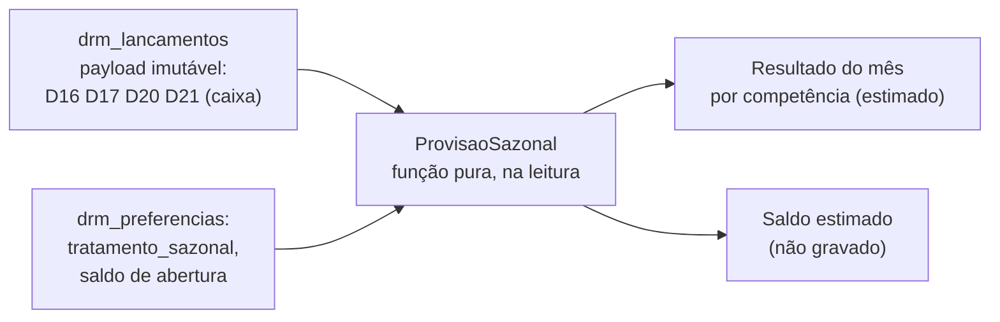

# ADR-011 — Provisão de rubricas sazonais (férias e 13º) no DRM

## Contexto

O `PDR-004`, decisão D, fixou como alvo a **provisão contábil completa** de férias e 13º: o sistema acumula 1/12 por mês, guarda o acúmulo e o baixa quando o pagamento ocorre. A dor que motivou o pedido é real e legítima: em caixa puro, dezembro parece um desastre porque o 13º foi pago inteiro, e o usuário lê queda de resultado onde houve concentração de despesa.

O `PDR-004` também registrou o conflito: provisão é uma **conta que atravessa meses**, saldo de provisão é **passivo**, e o DRM foi desenhado (`PDR-003`) como resultado em caixa puro, sem conta patrimonial. Esta ADR responde às 8 perguntas da `STORY-058` e recomenda um caminho.

**Duas premissas distintas estão em jogo, e a estória só nomeia uma.** Olhando o modelo de dados, a provisão colide com:

1. **A premissa de caixa puro** (`PDR-003`) — o que o enunciado já previa; e
2. **A independência entre snapshots** (`ADR-007`, herdada do `IDR-010`) — que ninguém havia nomeado. Cada competência é um registro imutável, calculado sem ler as demais, e retificar um mês nunca toca em outro (`ADR-007` §1, `STORY-050` CA-3). Provisão é, por definição, uma grandeza **cumulativa**: o saldo de dezembro depende de onze outros meses. Persistir esse saldo dentro dos snapshots obriga a escolher entre snapshots que dependem uns dos outros (e ficam obsoletos a cada retificação) ou saldo recalculado retroativamente (o que o `IDR-010` existe para impedir).

Essa segunda colisão é o centro técnico do problema, e é ela que decide a forma das opções abaixo.

**Fatos do estado atual que pesam na decisão (verificados nos documentos, não em dados de uso):**

- **Não existe uso real para medir.** As estórias de implementação do épico (`STORY-047`, `048`, `050`, `051`, `056`) estão todas `ready`; nada foi lançado por usuário. Qualquer estimativa de quantas empresas têm folha é hipótese. O próprio `PDR-004` diz "vale medir antes de investir".
- **A base de cálculo é fraca.** `D16` é, por definição do Anexo K, a **folha líquida paga** (sem encargos e sem a retirada do dono). O 13º e as férias incidem sobre a remuneração **bruta**. Deriva-se de `D16` uma *estimativa*, não um valor contábil.
- **`D16`, `D20` e `D21` só existem no modo detalhado** do grupo de despesas administrativas (Anexo K §K.5). Quem lança `D15` agregado — o caminho de menor atrito, que o produto incentiva — não tem salário, férias nem 13º no payload. Para esse usuário, qualquer provisão derivada é impossível sem pedir mais campos.
- **O público tem folha pequena.** O MEI pode ter no máximo um empregado; muitas empresas do Simples têm poucos. Não há como tratar o saldo por empregado: o DRM não tem cadastro de funcionários (seria folha de pagamento, outro produto).
- **O payload já guarda o necessário.** `lancamento_payload` (imutável) contém `D16`, `D17`, `D20`, `D21` individualmente. Isso significa que **a porta da provisão derivada continua aberta sem que nada seja feito agora** — ver Decisão.

### Restrições herdadas que esta decisão respeita sem reabrir

`PDR-003` (caixa puro, módulo independente), `PDR-004` D (provisão é o alvo; spike define o caminho), `ADR-003` (multi-tenancy, UUID v7, `CHECK`, soft delete), `ADR-007` (snapshots append-only, comparativos derivados na leitura, `drm_preferencias`), `IDR-010` (sem recálculo retroativo), Anexo K §K.5-A e §K.8.

## Forças (drivers) da decisão

| ID | Força | Peso |
|---|---|---|
| **F1** | A série histórica é o ativo do módulo — não pode ser degradada sem decisão consciente (CA-6) | **Alto** |
| **F2** | Independência de snapshots e ausência de recálculo retroativo (`ADR-007`, `IDR-010`) | **Alto** |
| **F3** | Persona MEI/Simples não tem escrita contábil e não deve ser empurrada a escrever contabilidade (`PDR-003`) | **Alto** |
| **F4** | Entregar a intenção do pedido da EBC: dezembro não parecer desastre, e dar ao dono visão do que deve | **Alto** |
| **F5** | Simplicidade e custo de teste — time muito pequeno, módulo novo inteiro na onda (princípio #1) | **Alto** |
| **F6** | Honestidade do número: uma estimativa não pode ser exibida com cara de saldo contábil | **Alto** |
| **F7** | Reversibilidade e não-hipoteca: a escolha de hoje não pode fechar a de amanhã (princípio #7) | **Médio** |
| **F8** | Evidência antes de investimento — não há dado de uso (princípio #11) | **Médio** |

## Opções consideradas

### Opção 1 — Contabilidade completa: o saldo vira conta persistida
- **Resumo:** nova(s) tabela(s) de razão da provisão (`drm_provisoes` com movimentos de provisão e baixa por rubrica e competência, saldo corrente persistido). O sistema lança a provisão mensal, baixa contra `D20`/`D21`, apura ajuste e encerra exercício. É a leitura literal da decisão D.
- **Princípios:** ❌ simplicidade (um segundo modelo de dados com semântica de razão); ❌ reversibilidade (saldo persistido, depois de usado, é caro de desfazer); ⚠️ `ADR-007` (saldo persistido ou é recalculado em cascata a cada retificação — violando o `IDR-010` — ou fica obsoleto).
- **Prós:** entrega exatamente o que a EBC pediu; saldo auditável; base para uma eventual folha/Plano Pro de contador.
- **Contras:** contradiz `PDR-003` e **reabre** a premissa que torna o módulo acessível ao MEI; exige cadastro de funcionários para ser correto (saída no meio do ano, rescisão); depende de `D16` bruto, que não temos; cascata de retificação; público-alvo declarado do módulo não opera esse modelo.

### Opção 2 — Lente de provisão **derivada** na leitura (saldo calculado, nunca gravado)
- **Resumo:** o dado persistido continua sendo caixa. Uma função pura (`ProvisaoSazonal`, no namespace `Drm`) lê o `lancamento_payload` de cada competência vigente e produz, **na leitura**, (a) um ajuste de resultado do mês — *provisão do mês* no lugar de `D20 + D21` pagos — e (b) um **saldo estimado** acumulado, somado sobre as versões vigentes. Parâmetro de leitura `tratamento_sazonal ∈ {caixa, provisao}` em `drm_preferencias`, no mesmo molde do pró-labore (`ADR-007` já reservou o lugar). Saldo de abertura opcional (um número por rubrica, com data) também em `drm_preferencias`.
- **Princípios:** ✅ simplicidade (nenhuma tabela nova de razão; uma função pura; testável sem banco); ✅ F2 (nada é recalculado nem persistido — mesma mecânica dos comparativos); ✅ reversibilidade (alternar é trocar um parâmetro); ⚠️ honestidade do número (depende de rotular como estimativa).
- **Prós:** entrega o efeito (dezembro normalizado, estimativa de reserva) sem conta patrimonial **persistida** nem escrita contábil pelo usuário; retificação funciona sozinha (saldo é derivado das vigentes).
- **Contras:** o módulo passa a mostrar **dois resultados** para o mesmo mês (caixa e por competência) — rompe a promessa do `PDR-004` B de que o parâmetro de leitura "não muda o Lucro Líquido"; funciona só para quem lança `D16` detalhado; base líquida e sem cadastro de funcionário = estimativa grosseira; saldo exibido sugere reserva que pode não existir no banco.

### Opção 3 — Status quo (`STORY-051`/Anexo K §K.8) e medir
- **Resumo:** manter caixa puro com alerta `A4`, marcação na série e comparativo explicado. Acrescentar uma **medição** (consulta somente leitura sobre `lancamento_payload` e eventos) para decidir com dado se a Opção 2 vale. Nada novo no modelo.
- **Princípios:** ✅ simplicidade; ✅ reversibilidade total; ✅ evidência antes de investimento (F8); ❌ F4 só parcialmente atendida.
- **Prós:** custo de modelagem zero; série histórica intacta; não hipoteca nada.
- **Contras:** **explica** a queda, mas **não a remove nem permite planejar** — o usuário continua sem saber quanto reservar. Ver a seção "O que o usuário perde".

### Opção 4 — Provisão informada pelo usuário (campo "provisionado no mês")
- **Resumo:** novos campos de lançamento onde o dono digita quanto provisionou.
- **Descartada sem análise pesada:** devolve contabilidade ao público que o módulo existe para poupar disso (F3), aumenta o atrito de lançamento (risco nº 1 do épico) e cria um segundo lugar com o mesmo fato (`D20`/`D21` pagos × provisão digitada).

## Matriz comparativa

| Força | Peso | 1 Contábil completa | 2 Lente derivada | 3 Caixa + medir |
|---|---|---|---|---|
| F1 — série histórica | Alto | ❌ saldo persistido contamina a série | ⚠️ ligar altera o lucro exibido do passado (ver P7) | ✅ intacta |
| F2 — snapshots independentes | Alto | ❌ cascata ou obsolescência | ✅ derivado | ✅ |
| F3 — persona sem escrita contábil | Alto | ❌ | ✅ (não escreve nada) | ✅ |
| F4 — entregar a intenção | Alto | ✅ | ⚠️ só para quem lança `D16` | ⚠️ explica, não planeja |
| F5 — simplicidade / teste | Alto | ❌ razão + encerramento + funcionário | ⚠️ 1 função pura + lente em toda a leitura e exportação | ✅ |
| F6 — honestidade do número | Alto | ⚠️ parece contábil, base é estimada | ⚠️ exige rótulo "estimativa" | ✅ |
| F7 — reversibilidade | Médio | ❌ | ✅ | ✅ |
| F8 — evidência antes de gastar | Médio | ❌ | ⚠️ | ✅ |

## Decisão proposta

> **Optamos pela Opção 3 (saída C), com a Opção 2 pré-desenhada e condicionada a gatilho medido. A Opção 1 (saída B) não é recomendada dentro do DRM.**

1. **Agora:** o DRM permanece em caixa puro para férias e 13º. O tratamento vigente (Anexo K §K.8, `STORY-051`) é suficiente para **não induzir leitura errada** do mês; não é suficiente para **planejamento de caixa**. Esta ADR declara essa limitação em voz alta (seção "O que o usuário perde").
2. **Medir:** abrir uma estória pequena de medição somente-leitura (ver "Para o time"), a rodar depois do primeiro dezembro com lançamentos reais.
3. **Degrau seguinte, se o gatilho disparar:** Opção 2, com o desenho das Respostas abaixo. **Nada precisa ser feito agora nas estórias de implementação para mantê-la viável** — o payload imutável já guarda `D16`/`D17`/`D20`/`D21` e `drm_preferencias` já foi desenhada para receber `tratamento_sazonal` (`ADR-007`, omissão declarada §4).
4. **A Opção 1 só se justifica se o produto mudar de persona** (contador, Plano Pro). Nesse caso é novo épico e o `PDR-003` é reaberto formalmente.

### Relação com a premissa de caixa puro do `PDR-003` (CA-2)

| Caminho | Relação com `PDR-003` |
|---|---|
| Opção 3 (recomendada) | **Preserva.** |
| Opção 2 (degrau seguinte) | **Preserva a persistência e a entrada; estende a apresentação.** O usuário nunca lança provisão nem saldo; o que é gravado continua sendo caixa. Mas o módulo passa a *exibir* um resultado por competência estimado. Isso **altera a letra** de "resultado em caixa puro" — o PO deve registrar a extensão no `PDR-003` se a Opção 2 for acionada. Não é contradição de fundo, mas também não é "nada mudou". |
| Opção 1 | **Contradiz.** O módulo passa a ter conta patrimonial persistida. Exige reabrir o `PDR-003`. |

## Respostas às 8 perguntas

Valem para a Opção 2 (o único caminho de provisão que esta ADR considera viável no DRM). Para a Opção 3 não há nada a responder — nada muda.

### 1. Onde mora o saldo?
**Em lugar nenhum — é uma grandeza derivada.** Saldo estimado = Σ(provisão do mês) − Σ(pago em `D20`/`D21`) sobre as versões vigentes, calculado na leitura, no mesmo regime dos comparativos (`ADR-007`: "comparativos não são persistidos"). Única exceção: o **saldo de abertura** opcional (Q5), um número por rubrica e uma data em `drm_preferencias` — dado de configuração, sem movimentos. Alternativa (tabela de razão) descartada pelo motivo central do Contexto: cria dependência entre snapshots.

### 2. Base de cálculo
- **Derivada de `D16`, rotulada como estimativa.** Coeficientes: 13º = 1/12 ≈ 8,33% da base/mês; férias = 1/12 × 4/3 ≈ 11,11%/mês. Alternativa "usuário informa a base" descartada (F3, atrito).
- **Limite assumido:** `D16` é líquido; a base correta é bruta. O erro típico fica na ordem de grandeza de um dígito percentual para salários baixos, mas **não é auditável** e deve ser dito na tela.
- **Encargos:** FGTS (8%) sobre as duas rubricas é provisionável por regra simples. INSS patronal depende do regime (no Simples Nacional, anexos I a III, está dentro da guia única; fora disso não) — **a validar com a EBC**; a recomendação é provisionar só o FGTS e declarar o resto como não coberto, em vez de errar o INSS em regimes diferentes.
- **Não existe para quem lança `D15` agregado** (`D16` ausente). O parâmetro só tem efeito no modo detalhado; no agregado, a tela diz por quê.

### 3. Baixa contra o pagamento
Derivada: o pago (`D20`/`D21`) reduz o saldo estimado no mês em que aparece. **A diferença entre pago e provisionado fica como saldo residual** (positivo ou negativo), nunca vira ajuste automático no resultado — um ajuste automático recriaria o pico que a provisão existe para evitar. Alerta quando |saldo| ultrapassar um mês de base, convidando o usuário a rever o saldo de abertura.

### 4. Virada de exercício e saída de funcionário
- **Virada:** o saldo **não zera em 31/12** — férias não têm calendário; o saldo atravessa o ano naturalmente. Sem rotina de encerramento.
- **Saída de funcionário:** **o sistema não consegue tratar** — o DRM não sabe quantos funcionários existem. A rescisão (férias e 13º proporcionais pagos de uma vez) aparece como pagamento alto sem saldo correspondente, e o saldo estimado fica distorcido até o usuário ajustar o saldo de abertura. Este é um limite estrutural da Opção 2, não bug: corrigi-lo exige cadastro de funcionários, ou seja, folha (Opção 1).

### 5. Início de uso
**Sem retroativo e com saldo de abertura opcional.** Meses não lançados não têm `D16`, logo não há o que provisionar retroativamente; inventar seria violar a regra "nunca inferir dado que o usuário não deu" (`ADR-007` §4). Quem liga a lente em setembro e não informa saldo vê, no primeiro dezembro, um 13º pago contra apenas 4/12 provisionados — saldo negativo grande e potencialmente alarmante. Por isso a tela deve **oferecer o saldo de abertura no momento de ligar** e explicar o efeito se ficar em branco.

### 6. Retificação (`STORY-045` / `IDR-010`)
Como o saldo é derivado das versões vigentes, retificar o mês *m* **muda o saldo exibido dos meses seguintes**, sem tocar em nenhum registro persistido — a mesma propriedade que torna impossível violar o CA-5 da `STORY-050` para comparativos. Compatível com `ADR-007` (nenhuma competência é recalculada *no banco*) e com `IDR-010` (o snapshot de cada mês segue sendo o que o usuário viu em caixa). **Custo declarado:** o saldo exibido de um mês passado pode mudar depois de uma retificação anterior. A tela deve dizer ("saldo recalculado: retificação de MM/AAAA"). Com a Opção 1 (saldo persistido) esse problema não tem solução limpa.

### 7. Comparabilidade da série (CA-6)
- **Opção 3:** série **intacta** — caixa em todos os meses, com marcação de atípico. Nenhum custo.
- **Opção 2:** a lente é um parâmetro de leitura aplicado a **toda a série** (regra do §K.5-A). Ligá-la **muda o resultado exibido de meses passados que tinham `D20`/`D21`/`D16`**. Diferente do pró-labore, **aqui o Lucro Líquido muda** entre os dois modos. É aceitável se, e somente se: (a) é reversível com um clique; (b) o modo vigente aparece sempre ao lado do número; (c) a exportação carrega o mesmo rótulo; (d) o default permanece `caixa`. Aplicar a lente só do mês de ativação em diante é **proibido**: criaria uma série mista em que variação mês a mês mede a troca de método, não o negócio.
- **Opção 1:** degrada a série de forma irreversível se o saldo for persistido sem recalculo, ou a recalcula em cascata.

### 8. Alcance
**Só férias e 13º. Não abre precedente.** Esses dois itens têm fórmula legal e base derivável de campos já lançados. IPTU anual, seguro anual e licença de software não têm base derivada nem regra legal de apropriação: exigiriam que o usuário informasse valor anual e meses de cobertura — uma funcionalidade diferente (diferimento de despesa), com atrito próprio. Regra proposta: **a lente só admite rubrica cuja apropriação seja função pura de outros campos já lançados.** Qualquer outra é nova decisão.

## Custo estimado de cada saída, em modelagem (CA-3)

| Saída | Agregados / tabelas | Invariantes que mexem | Estórias |
|---|---|---|---|
| **A** — Opção 2 (cabe no EPIC-010 se acionada) | Nenhuma tabela nova. 3 colunas em `drm_preferencias`. 1 função pura sem estado. `drm_lancamentos` não muda de forma | Nenhum invariante de `ADR-007` quebra. Muda a letra do `PDR-003` e a promessa "parâmetro não muda o Lucro Líquido" do `PDR-004` B | ~5, ver "Para o time" |
| **B** — Opção 1 (novo épico) | Tabela de razão (movimentos + saldo), cadastro de funcionários para ser correto, rotina de encerramento | Quebra independência de snapshots (F2) ou impõe cascata; contradiz `PDR-003`; muda a persona | ≥ 8, e novo épico |
| **C** — Opção 3 (recomendada) | Nenhum | Nenhum | 1 pequena (medição) |

## O que o usuário perde em relação à decisão da EBC (CA-5)

Sem eufemismo. Escolhendo C, o usuário **não** recebe a provisão contábil. Concretamente, perde:

1. **Resultado mensal normalizado.** Vê dezembro marcado como atípico e explicado, mas o número continua sendo o do caixa. Não existe "lucro sem a sazonalidade".
2. **Estimativa de quanto reservar.** É a perda mais prática: o dono não é avisado de que em novembro/dezembro terá um desembolso de ~1 salário a mais. **O tratamento vigente explica o passado; não ajuda a planejar o futuro.**
3. **Visibilidade da obrigação acumulada.** Férias vencidas e 13º em formação não aparecem.

**Por que o tratamento vigente é, ainda assim, suficiente para o MVP:** a dor registrada no `PDR-004` é de **leitura errada** ("parece um desastre"), e `A4` + marcação + comparativo explicado a resolvem; planejamento de caixa é outra dor, que o DRM não prometeu e que ninguém pediu ainda em dados. Em contrapartida, **três fragilidades do tratamento vigente** — para o PO considerar, sem alterar a `STORY-051`:

- `A4` só dispara **a partir do 4º lançamento**. Quem começa em outubro chega ao primeiro dezembro com 3 lançamentos e **sem alerta justamente no mês atípico**, no caso do usuário novo.
- `A4` não distingue sazonalidade de erro de digitação (o texto do alerta cobre os dois).
- Em modo agregado (`D15`), `D20`/`D21` não existem; a sazonalidade da folha fica invisível, embora o impacto no resultado seja o mesmo.

**Escolher C não recusa a decisão da EBC:** é informá-la do custo real. A tradução honesta para a EBC: *a provisão completa exige contabilidade de folha que o público do módulo não tem; entregamos a leitura correta do mês agora, medimos a demanda após o primeiro dezembro, e temos desenhada uma versão estimada (sem conta patrimonial) para quando houver evidência.*

## Consequências

### Positivas
- Zero custo de modelagem e de teste agora; nenhuma estória do épico muda.
- Série histórica intacta; `IDR-010` e `ADR-007` preservados.
- O caminho de provisão fica **desenhado e dimensionado**, não só "adiado".

### Negativas / trade-offs aceitos
- A expectativa da EBC (decisão D) não é atendida no prazo do épico; fica condicionada a evidência.
- O planejamento de caixa de dezembro não é ajudado pelo produto no MVP.
- O saldo de abertura é a única entrada patrimonial da Opção 2, e o usuário comum não sabe o próprio valor — risco de adoção se a Opção 2 for acionada.

### Para o time
- **Impacto em estórias existentes:** nenhum. `STORY-051` entrega independentemente; `STORY-057` (validação) valida o que existe, **sem implementação de provisão**. O Anexo K §K.5-A e §K.8 seguem corretos como estão.
- **Estória nova proposta (PO decide criar):** *Medição de rubricas sazonais* (tamanho S) — consulta somente-leitura sobre `lancamento_payload` (`D16`, `D20`, `D21`) e eventos `drm_*`: % de empresas ativas com `D16 > 0`; % com `D20`/`D21` > 0; % em modo agregado; frequência de `A4` disparado por `D20`/`D21`; frequência de pedido explícito. Sem alterar produção, sem novo dado pessoal.
- **Se o gatilho disparar (Opção 2), estórias previstas:** (1) função pura `ProvisaoSazonal` com golden tests e bump de versão própria da fórmula; (2) `tratamento_sazonal` e saldo de abertura em `drm_preferencias` + tela de parâmetros; (3) lente na tela de demonstração e na série, com rótulo permanente do modo; (4) saldo estimado e alertas (|saldo| alto, ausência de `D16`); (5) exportação (XLSX com fórmulas; impressão) carregando o rótulo. Épico: continua no EPIC-010 se ainda aberto; senão novo épico pequeno.
- **ADRs/PDRs que esta decisão limita ou destrava:** limita o `PDR-004` D (alvo vira condicional a evidência); não altera `PDR-003` enquanto C vigorar.
- **Necessidade de spike de validação:** não. Se a Opção 2 for acionada, os coeficientes e o tratamento de INSS passam por validação da EBC.

## Plano de verificação

- **Como verificar conformidade:** nenhuma migration do EPIC-010 cria tabela de saldo/provisão; teste arquitetural proíbe colunas `provisao`/`saldo` em `drm_lancamentos`. Isso é regressão de uma regra, não de uma feature.
- **Sinais de revisão (quando reabrir):** gatilho numérico a ser fixado pelo PO. Proposta de partida, para discussão: a medição pós-primeiro-dezembro mostrar que **uma parcela relevante das empresas ativas (sugestão: ≥ 20%) lança `D20`/`D21`** *e* aparecerem **pedidos explícitos de provisão ou de "quanto reservar"** no feedback; ou a EBC/PO decidir pivotar para persona contador (aí é Opção 1, novo épico, `PDR-003` reaberto).
- **Sinais de que C foi a escolha certa:** `A4` + marcação bastam — poucos usuários com folha, nenhum pedido de reserva.

## Aprovação humana

- **Status final:** ⬜ pendente
- **Aprovado por:** —
- **Data:** —
- **Forma do aceite:** —
- **Condicionantes do aceite:** —

## Histórico

- 2026-11-05 — criada como `proposed` por Arquiteto, a pedido da `STORY-058`. Numeração: `ADR-010` está reservado a outra estória.
